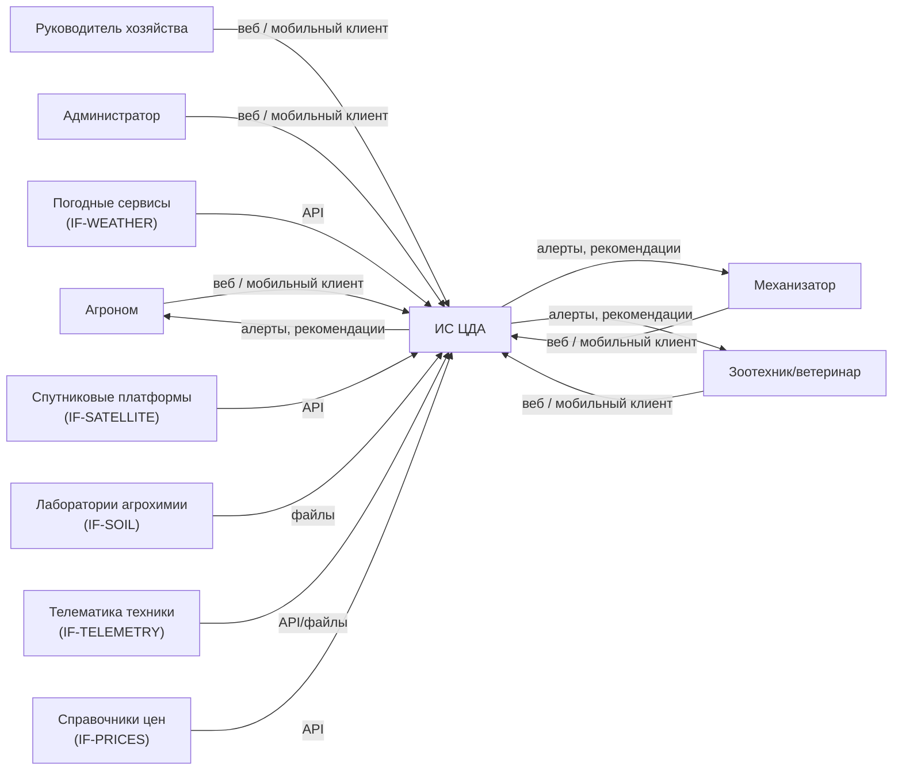
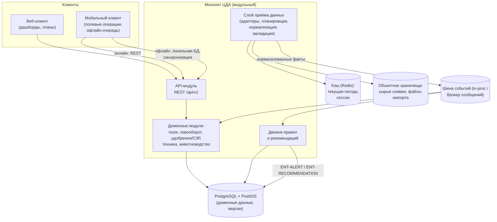

# Архитектура ИС ЦДА

Статус: готово · Версия: 1.0 · Дата: 2026-11-05 · Автор: Иван Куликов

Опирается на docs/01-requirements.md (REQ, роли, сценарии SC-01..05) и CONTRACTS.md (§4–§8).
Форматы данных — CONTRACTS §5; сущности ENT — §6; интерфейс адаптеров — §7.

## 1. Общий подход

Трёхслойная модульная архитектура вокруг единой доменной модели хозяйства:

1. Слой источников (адаптеры IF-, CONTRACTS §7) — приём внешних данных, нормализация, валидация.
2. Доменный слой — модули подсистем цели (поля, севооборот, удобрения/СЗР, техника,
   животноводство) + движок правил и рекомендаций.
3. Слой предоставления — REST API `/api/v1` (CONTRACTS §8), веб-клиент и мобильный клиент.

Выбор в пользу модульного монолита с внутренней шиной событий, а не микросервисов,
обоснован в ADR-01. Ключевой принцип:_recommendации строятся только из данных
доменной модели (single source of truth), внешние источники никогда не читаются
клиентами напрямую.

## 2. Уровень контекста (C4, уровень 1)

Актёры и источники соответствуют ролям из 01-requirements §2 и источникам из
research/02-data-sources.md; детали каждого адаптера — в docs/05-integrations.md.

## 3. Уровень контейнеров (C4, уровень 2)

## 4. Модули и их ответственность

| Модуль | Подсистема цели | Ответственность | Ключевые ENT / REQ |
|---|---|---|---|
| mod-fields | Поля | контуры и версии полей, площадь, агрохимия, карточка «360°» | ENT-FIELD, REQ-F-001..004, 031 |
| mod-rotation | Севооборот | многолетние планы, проверка предшественников и возврата | ENT-ROTATION-PLAN, ENT-CROP-CYCLE, REQ-F-005..008 |
| mod-inputs | Удобрения и СЗР | справочник, планы внесения, баланс доз, журнал обработок | ENT-AGRO-INPUT, ENT-TREATMENT-PLAN, ENT-FIELD-OPERATION, REQ-F-009..013 |
| mod-machinery | Техника | парк, работы, телематика, ТО | ENT-MACHINE, ENT-MACHINE-JOB, REQ-F-014..017, 032 |
| mod-livestock | Животноводство | стада, животные, рационы, ветсобытия, кормовой баланс, навоз | ENT-HERD/ENT-ANIMAL-GROUP, ENT-ANIMAL, ENT-RATION, REQ-F-018..022 |
| mod-weather | Погода | нормализация погодных фактов/прогнозов, погодные окна | ENT-WEATHER-OBSERVATION, ENT-FORECAST, REQ-F-023..026 |
| mod-satellite | Спутниковый мониторинг | снимки, NDVI/NDRE таймлайны, аномалии | ENT-SATELLITE-SCENE, REQ-F-027..030 |
| ingest-gateway | Прочие источники | планировщик опроса адаптеров, журнал источников, качество данных | IF-ADAPTER-статусы, REQ-F-034, REQ-NF-009 |
| rules-engine | Сквозной | исполнение правил доменов, генерация ENT-ALERT/ENT-RECOMMENDATION | REQ-NF-006 |

Правила доменных логик (совместимость культур, дозы, сроки ожидания, карантин и т.д.)
формализованы в docs/03-domain-agronomy.md и docs/04-domain-farm.md; rules-engine —
исполнитель этих правил, сами правила в коде модулей-владельцев.

### Публичные интерфейсы между модулями

Модули общаются только через: (1) чтение доменных данных из БД, (2) события шины,
(3) явные вызовы сервисных функций своего слоя. Запрещены прямые SQL-запросы к
чужим таблицам. Событие — JSON по §5, формат: `{"event": "<имя>", "occurred_at":
"<ISO 8601>", "entity": "ENT-...", "entity_id": "<uuid>", "payload": {...}}`.

Основные события: `field.boundary.updated`, `crop_cycle.planned`, `treatment.plan.approved`,
`operation.logged`, `observation.ingested` (погода), `scene.ingested` (спутник),
`telemetry.imported`, `ration.changed`, `veterinary.event.created`.

## 5. Ключевые потоки данных

Поток 1 — плановый (SC-01): агроном правит план севооборота → mod-rotation
проверяет правила → нарушение сохраняется как предупреждение к плану →
`crop_cycle.planned` → руководитель согласует.

Поток 2 — данные → рекомендация (SC-02): ingest-gateway по расписанию получает
снимок/погоду → нормализует (ENT-SATELLITE-SCENE / ENT-WEATHER-OBSERVATION) →
`scene.ingested` → rules-engine пересчитывает дозу N-P-K → создаёт ENT-RECOMMENDATION
с объяснением (REQ-NF-006) → алерт агроному.

Поток 3 — полевая операция (SC-03, SC-04): погодное окно рассчитывает mod-weather
по правилам mod-inputs → задание в мобильный клиент → офлайн-запись факта →
синхронизация → `operation.logged` → mod-machinery связывает работу техники →
расхождение с планом >10 % (REQ-F-013) подсвечивается.

Поток 4 — животноводство ↔ земледелие (SC-05): изменение ENT-RATION → пересчёт
потребности в кормах → сопоставление с кормовыми культурами mod-rotation;
выход навоза → mod-inputs (баланс N-P-K).

Деградация при недоступности источника (REQ-NF-009): адаптер возвращает
`SourceUnavailableError` → ingest-gateway ставит ретрай с экспоненциальной
задержкой → UI показывает последнее известное значение с датой и меткой «данные
устарели»; функции, зависящие от источника, помечаются недоступными, ядро работает.

## 6. Хранение данных

- PostgreSQL + PostGIS: все DAT-таблицы (docs/06-data-api.md); геометрия контуров —
  тип geography/geometry; индексы GIST по контурам.
- Версионирование: аудиторская таблица изменений (кто, когда, что изменил) +
  история версий контуров полей (REQ-F-002, REQ-NF-005).
- Redis (или аналог): кэш текущей погоды, прогнозов, сессии; TTL по §05-integrations.
- Объектное хранилище: сырые снимки, импортированные файлы (KML, результаты
  агрохимии, треки) — нормализованные выжимки идут в PostgreSQL.
- Резервное копирование: ежедневный дамп PostgreSQL + версия объектного хранилища;
  RPO ≤24 ч, RTO ≤8 ч (REQ-NF-010).

## 7. Технологический стек

| Слой | Выбор | Обоснование |
|---|---|---|
| Backend | Python (FastAPI) | быстрая разработка, экосистема агро/GEO-библиотек (rasterio, shapely, geopandas), асинхронность для адаптеров |
| БД | PostgreSQL 16 + PostGIS | транзакционность, гео-типы для контуров (REQ-F-001), один источник правды |
| Кэш/очередь | Redis + встроенная очередь задач (например, APScheduler/Celery) | расписания опроса источников, ретраи, кэш с TTL |
| Клиенты | Веб: SPA (Vue/React — фиксируется при старте реализации); мобильный: PWA | PWA даёт офлайн-очередь (REQ-NF-003) без двух нативных кодовых баз |
| Инфраструктура | Контейнеры, оркестрация по облачному тарифу; HTTPS, reverse-proxy | масштаб задачи (REQ-NF-001) не требует собственного ДЦ |

Финальный выбор SPA-фреймворка и брокера — ADR при старте реализации; критерии
перечислены в ADR-02/ADR-03.

## 8. Архитектурные решения (ADR)

### ADR-01: модульный монолит + внутренняя шина событий вместо микросервисов

Контекст: 8 подсистем, команда реализации небольшая, нагрузки умеренные (REQ-NF-001).
Решение: один деплоймент с модулями по §4; коммуникация через события и БД.
Альтернативы: микросервисы (отвергнуто: операционная сложность, издержки на
консистентность домена), чистый монолит без событий (отвергнуто: связанность
модулей при потоках «данные → рекомендация»).
Последствия: при росте модуль mod-satellite (тяжёлая обработка растров) выделяется
в отдельный сервис без смены контрактов, т.к. общается событиями.

### ADR-02: единое реляционное хранилище с PostGIS вместо отдельных хранилищ по подсистемам

Контекст: контуры, планы, журнал и животноводство связаны ссылками; нужны отчёты
по хозяйству сквозные.
Решение: PostgreSQL для всех доменных данных; сырые файлы — в объектном хранилище.
Альтернативы: документная БД для снимков/треков (отвергнуто: теряются связи и
транзакции), отдельная БД на модуль (отвергнуто: то же).
Последствия: обработка растров выполняется вне БД, в БД хранятся только выжимки
(индексы по полю, дата, качество).

### ADR-03: PWA-мобильный клиент с локальной БД синхронизации вместо нативных приложений

Контекст: механизматоры работают в полях без связи (REQ-NF-003).
Решение: PWA + IndexedDB-очередь; конфликт «факт vs план» решается приоритетом факта.
Альтернативы: нативные приложения (отвергнуто: две кодовые базы ради одного
сценария), работа только онлайн (отвергнуто: теряется SC-03/SC-04 в поле).
Последствия: ограничение по фоновым функциям телефона (приемлемо для MVP).

### ADR-04: рекомендации вычисляет rules-engine на данных домена, внешние источники — только через нормализованные ENT

Контекст: рекомендации должны быть объяснимы (REQ-NF-006) и воспроизводимы.
Решение: адаптеры пишут только нормализованные сущности; правила читают доменные
данные, каждое правило возвращает текст объяснения и ссылки на исходные данные.
Альтернативы: сквозные вызовы внешних API из правил (отвергнуто: зависимость от
доступности источников, необъяснимость).
Последствия: объём хранимых нормализованных данных растёт — принято, данные
истории и есть цифровой двойник.

## 9. Отражение нефункциональных требований

| REQ | Как обеспечено |
|---|---|
| REQ-NF-001 | масштаб заложен в одну БД + кэш; расчёт ёмкости: 200 полей, 5000 операций/год, снимки ~2 снимка/поле/месяц — объёмы порядка сотен ГБ за 10 лет, посильно для одной PostgreSQL-инстанции |
| REQ-NF-002 | цель производительности зафиксирована; кэш погоды, индексы по (field_id, date) |
| REQ-NF-003 | ADR-03, офлайн-очередь мобильного клиента |
| REQ-NF-004 | stateless API + БД: рестарт без потери данных; мониторинг — журнал адаптеров REQ-F-034 |
| REQ-NF-005 | роли в API-модуле, аудит-таблица (§6) |
| REQ-NF-006 | ADR-04 |
| REQ-NF-007 | экспорт доменных таблиц в JSON/CSV — сервис экспорта в API |
| REQ-NF-008 | локализация на уровне клиентов; форматы по CONTRACTS §5 |
| REQ-NF-009 | деградация источников (§5, CONTRACTS §7) |
| REQ-NF-010 | резервное копирование (§6) |

## 10. Открытые вопросы к детализации

- Финальный SPA-фреймворк и брокер сообщений — фиксируются новыми ADR на старте реализации.
- Формат аномалий NDVI (пиксель vs полигон зоны) — решается в 03/05 при описании
  ENT-SATELLITE-SCENE; влияет на ADR-02 (хранение полигонов зон).
- Пороговое расписание опроса источников — в 05-integrations.md (IF-адаптеры).
