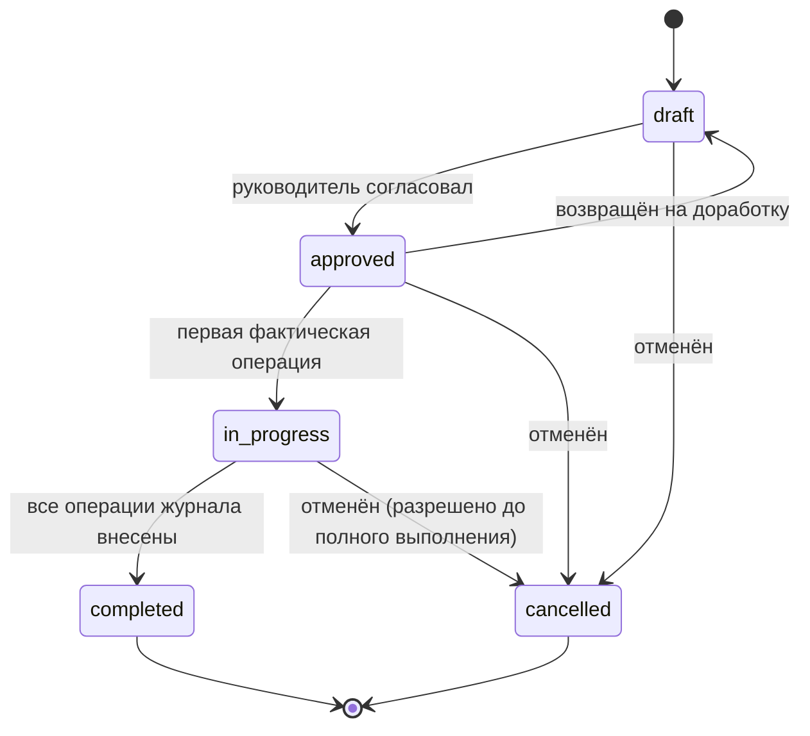
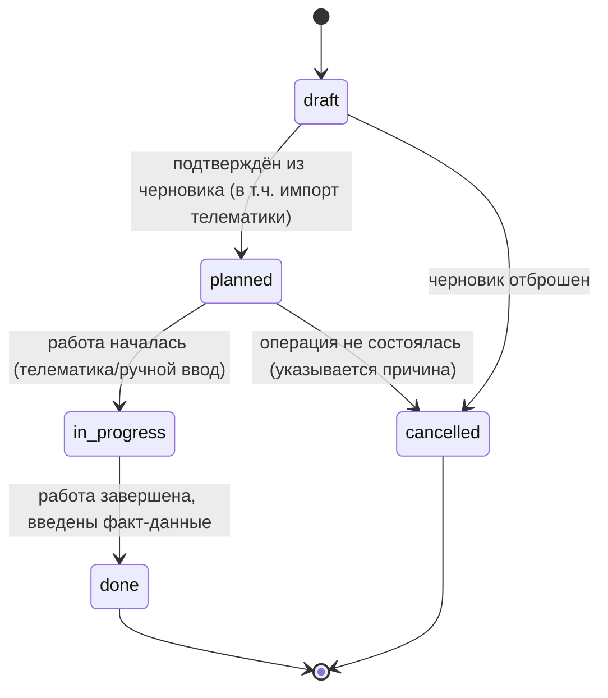
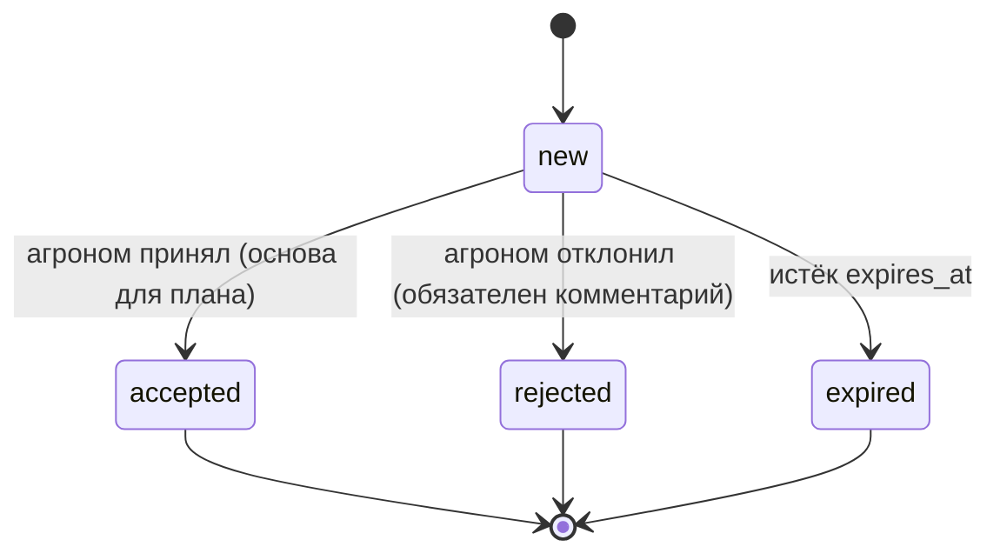

# Доменная модель агрономии: поля, севооборот, удобрения и СЗР

Статус: готово · Версия: 1.1 · Дата: 2026-11-05 · Автор: Светлана Куликова

Назначение: формализовать доменную логику подсистем «поля — севооборот — удобрения и СЗР» ИС ЦДА:
сущности с атрибутами, конечные автоматы статусов и проверяемые бизнес-правила, пригодные для
прямой реализации и тестов. Документ опирается на CONTRACTS.md §2–§6 и docs/01-requirements.md
(REQ-F-001…013, 023…034, REQ-NF-006; сценарии SC-01…SC-03) и использует выводы исследования
docs/research/01-analogues.md (REC-01…REC-05, REC-11). Сущности техники и животноводства —
в docs/04-domain-farm.md.

ID бизнес-правил имеют префикс `RULE-AGRO-NN`; он определён только в этом документе и закреплён
в CONTRACTS.md §4 (правила техники/животноводства `RULE-TECH-NN`/`RULE-LIVE-NN` — в 04).

## 1. Сущности и атрибуты

Типы: `UUID` (v4), `str`, `int`, `decimal(n,m)`, `date`/`datetime` (ISO 8601, §5), `enum`,
`GeoJSON Polygon` (WGS84, внешнее кольцо против часовой стрелки), `null` — отсутствие значения.
Все сущности имеют служебные поля `created_at`, `updated_at` (datetime) и `id` типа UUID — далее
не повторяются. Обязательные атрибуты помечены `*`.

### 1.1. ENT-FIELD — поле

| Атрибут | Тип | Ограничения |
|---|---|---|
| name* | str(100) | уникально в хозяйстве, непустое |
| contour* | GeoJSON Polygon | WGS84, кольцо CCW, площадь ≥ 0,1 га |
| area_ga* | decimal(10,2) | вычисляется системой (§6.1), > 0 |
| status* | enum | active, merged (объединено), archived |
| versions[] | список версий контура | version_no, contour, valid_from, reason |

Правило версионирования: при изменении контура создаётся новая версия; операции и циклы прошлых
сезонов остаются привязанными к версии, действовавшей на дату операции [REQ-F-002].

Пример JSON (§5):

```json
{
  "field_id": "0b2a5b0e-6f3f-4e5c-9b1d-7f4a1c2d3e01",
  "name": "Степное-7",
  "contour": {
    "type": "Polygon",
    "coordinates": [[[41.9812, 48.7314], [41.9910, 48.7312], [41.9913, 48.7261],
      [41.9810, 48.7263], [41.9812, 48.7314]]]
  },
  "area_ga": 84.53,
  "status": "active",
  "versions": [
    {"version_no": 1, "valid_from": "2026-04-01", "reason": "импорт GeoJSON", "area_ga": 84.53}
  ]
}
```

### 1.2. ENT-ROTATION-PLAN — план севооборота

| Атрибут | Тип | Ограничения |
|---|---|---|
| field_id* | UUID | FK ENT-FIELD |
| year_from*, year_to* | int | year_to ≥ year_from, горизонт 2–10 лет |
| status* | enum | draft, approved, archived |
| approved_by / approved_at | str / datetime | обязательны при status=approved |
| items[]* | ссылки на ENT-CROP-CYCLE | ровно по одному циклу на год в диапазоне |

### 1.3. ENT-CROP-CYCLE — цикл культуры на поле за сезон

| Атрибут | Тип | Ограничения |
|---|---|---|
| field_id* / year* | UUID / int | пара уникальна (RULE-AGRO-04) |
| culture_id* | UUID | культура, «пар» или «сидерат» (справочник культур) |
| kind* | enum | main (основная), catch (промежуточная/сидерат), fallow (пар) |
| predecessor_cycle_id | UUID | предыдущий цикл того же поля, заполняет система |
| planned_yield_c_ha | decimal(6,1) | > 0, для расчёта доз (RULE-AGRO-05) |
| planned_harvest_date | date | для контроля сроков ожидания (RULE-AGRO-08) |
| status* | enum | planned, in_progress, completed |

Пример JSON:

```json
{
  "cycle_id": "2f6e9d8a-4c1b-4d9a-8f7e-3b2c1a0d9e02",
  "field_id": "0b2a5b0e-6f3f-4e5c-9b1d-7f4a1c2d3e01",
  "year": 2027,
  "culture_id": "c1a0d9e0-2f3b-4c8a-9d1e-7f4a1c2d3e03",
  "kind": "main",
  "predecessor_cycle_id": null,
  "planned_yield_c_ha": 45.0,
  "planned_harvest_date": "2027-07-20",
  "status": "planned"
}
```

### 1.4. ENT-AGRO-INPUT — удобрение или СЗР (справочник)

| Атрибут | Тип | Ограничения |
|---|---|---|
| kind* | enum | fertilizer, ppp (СЗР) |
| name* | str(200) | уникально |
| npk_content | decimal(4,1)×3 | % N, P2O5, K2O (для удобрений), иначе null |
| active_substance / concentration | str / decimal(5,2) | для СЗР, иначе null |
| unit* | enum | kg_ha (кг/га), l_ha (л/га), kg_dv_ha (кг д.в./га) |
| waiting_days | int | срок ожидания СЗР, дней; для удобрений null (RULE-AGRO-08) |
| approved_crops[] | UUID[] | допустимые культуры (RULE-AGRO-10); пусто = без ограничений |
| max_treatments_per_season | int | default 2 (RULE-AGRO-10) |
| restrictions | str | текст ограничений (температура, срок годности и т.п.) |

### 1.5. ENT-TREATMENT-PLAN — план внесения удобрений/СЗР

| Атрибут | Тип | Ограничения |
|---|---|---|
| cycle_id* | UUID | FK ENT-CROP-CYCLE |
| input_id* | UUID | FK ENT-AGRO-INPUT |
| dose* | decimal(8,2) | в единицах input.unit; ≥ 0 (RULE-AGRO-07) |
| operation_type* | enum | spraying (опрыскивание), fertilizing (внесение), seed_treatment |
| planned_date / planned_phase | date / str | фенофаза, напр. «кущение» |
| basis_recommendation_id | UUID | рекомендация-основание, если есть (RULE-AGRO-13) |
| status* | enum | по автомату §2.1 |

### 1.6. ENT-FIELD-OPERATION — операция на поле (журнал работ)

| Атрибут | Тип | Ограничения |
|---|---|---|
| field_id* / cycle_id* | UUID | FK; cycle_id = null для операций вне цикла (напр., пар) |
| operation_type* | enum | spraying, fertilizing, seeding, harvesting, tillage, other |
| date* | date | дата фактического выполнения |
| input_id | UUID | null для операций без препаратов |
| actual_dose | decimal(8,2) | фактическая доза, для обработки/внесения |
| actual_area_ga* | decimal(10,2) | ≤ 1,05 × площадь поля на дату операции (RULE-AGRO-12) |
| performer | str | механизатор/агроном |
| machine_job_id | UUID | ссылка на работу техники (docs/04) |
| source* | enum | manual, telemetry_import, plan_execution |
| deviation_flag* | bool | true, если |факт − план| / план > 10 % (RULE-AGRO-11) |
| status* | enum | по автомату §2.2 |
| cost_mode | enum | 'unit' (₽/га) \| 'total' (за поле); null — стоимости нет (2026-11-09, экономика §7.9 06-data-api) |
| cost_value | decimal | стоимость; при unit умножается на actual_area_ga; план = статусы draft/planned/in_progress, факт = done |

Справочник **ref_operation_cost** (DAT, 2026-11-09): operation_type (PK) →
rub_per_ga — нормативная расценка, ₽/га (fallback стоимости факта без cost;
типовые расценки региона — docs/reports/operation-costs-2026.md).

### 1.7. ENT-YIELD-RECORD — запись об урожайности

| Атрибут | Тип | Ограничения |
|---|---|---|
| cycle_id* | UUID | FK ENT-CROP-CYCLE |
| yield_c_ha* | decimal(6,1) | > 0 |
| gross_t | decimal(9,2) | валовой сбор, т |
| source* | enum | scales (весовая), combine_sensor, estimate |
| date* | date | дата уборки |

В потоке экономики (2026-11-09, §7.9 06-data-api): последняя запись цикла —
фактическая урожайность `yield_c_ha` для расчёта себестоимости тонны работ
(fact_cost / (ц/га ÷ 10 × га)); демо-данные — docs/reports/operation-costs-2026.md §6–7.

### 1.8. ENT-ALERT — оповещение

| Атрибут | Тип | Ограничения |
|---|---|---|
| type* | enum | weather_danger, ndvi_anomaly, deviation, machine_service, data_source |
| severity* | enum | info, warning, critical |
| field_id | UUID | null для хозяйственных алертов |
| payload* | JSON | детали события (правило, значения) |
| status* | enum | new, read, closed |

### 1.9. ENT-RECOMMENDATION — рекомендация системы

| Атрибут | Тип | Ограничения |
|---|---|---|
| rule_id* | str | идентификатор правила RULE-NN — источник (RULE-AGRO-13) |
| target_type* / target_id* | enum / UUID | field, crop_cycle, treatment_plan |
| action* | str(500) | предлагаемое действие с числом (доза, дата, операция) |
| rationale* | str(1000) | человекочитаемое обоснование «почему» (REQ-NF-006) |
| data_refs[]* | JSON[] | входные данные: ссылки на сущности и измерения |
| status* | enum | new, accepted, rejected, expired |
| expires_at | datetime | срок актуальности, напр. для погодного окна |

Пример JSON:

```json
{
  "recommendation_id": "9d8c7b6a-5e4f-4d3c-2b1a-0f9e8d7c6b04",
  "rule_id": "RULE-AGRO-05",
  "target_type": "crop_cycle",
  "target_id": "2f6e9d8a-4c1b-4d9a-8f7e-3b2c1a0d9e02",
  "action": "Внести азот 62 кг д.в./га в фазу кущения (аммиачная селитра, 180 кг/га тука)",
  "rationale": "Баланс N: вынос 126, запас почвы 13, (126-13)/0,6=188 кг д.в./га; минус основное внесение 126 = 62 кг.",
  "data_refs": [
    {"cycle_id": "2f6e9d8a-4c1b-4d9a-8f7e-3b2c1a0d9e02"},
    {"source": "agrochem", "sample_date": "2026-09-15"},
    {"source": "yield_plan", "value_c_ha": 45.0}
  ],
  "status": "new",
  "expires_at": null
}
```

## 2. Конечные автоматы статусов

### 2.1. ENT-TREATMENT-PLAN



### 2.2. ENT-FIELD-OPERATION



### 2.3. ENT-RECOMMENDATION



## 3. Бизнес-правила

Формат: условие в виде, пригодном для реализации и тестов; параметры — в справочниках,
редактируемых администратором; значения по умолчанию — по агрономическим справочникам и
помечаются как требующие валидации агрономом хозяйства.

### 3.1. Севооборот

**RULE-AGRO-01. Совместимость культуры и предшественника.**
Посев культуры C на поле после предшественника P допустим, только если значение матрицы
`compat[P][C]` равно `allowed`. Значение `warn` — допустимо с обязательным комментарием агронома;
`forbidden` — ввод блокируется, пользователю показывается текст правила. Матрица — справочник
(фрагмент ниже), редактируемый; классификация культур — по биологическим группам.

| Предшественник P | Культура C | compat | Комментарий |
|---|---|---|---|
| оз. пшеница | оз. пшеница | forbidden | повторный посев зерновых истощает почву, болезни |
| оз. пшеница | горох | allowed | хороший предшественник, N-фиксация |
| пар | оз. пшеница | allowed | классическая пара |
| рапс | рапс | forbidden | возврат не менее 4 лет (кила и др.) |
| картофель | картофель | warn | допустимо на песчаных почвах, риск нематоды |
| сидерат (горчица) | ячмень | allowed | улучшение фитосанитарного состояния |

Обслуживает [REQ-F-006], SC-01.

**RULE-AGRO-02. Минимальный возврат культуры.**
Повторный посев культуры C на том же поле допустим, только если год посева − год последнего
посева C на этом поле ≥ `repeat_years[C]` (default 3; рапс 4, сахарная свёкла 4, картофель 5 —
требует валидации). Проверка по истории ENT-CROP-CYCLE поля. Нарушение — как `warn` в RULE-AGRO-01.
Обслуживает [REQ-F-007], SC-01.

**RULE-AGRO-03. Пар и промежуточные культуры.**
Пар (kind=fallow) и сидерат (kind=catch) — полноправные элементы цепочки: предшественником для
следующего цикла является последний цикл поля любого kind. Год не может остаться пустым: если
культура не планируется, создаётся цикл `fallow` или цикл с пометкой `out_of_rotation`
(причина указывается). Обслуживает [REQ-F-008], SC-01.

**RULE-AGRO-04. Целостность цепочки.**
На поле и год допускается ровно один цикл с kind=main (плюс произвольное число kind=catch).
Изменение и удаление циклов прошлых лет (статус completed) запрещено; исправление — только
корректирующей записью с датой и причиной. Обслуживает [REQ-F-002], [REQ-F-005], SC-01.

### 3.2. Удобрения

**RULE-AGRO-05. Баланс N-P-K (расчёт дозы).**
Рекомендуемая доза элемента питания e ∈ {N, P2O5, K2O} в кг д.в./га:

```
D_e = max(0, (V_e · Y − A_e · k_soil_e) / k_fert_e)

Y     плановая урожайность, ц/га (ENT-CROP-CYCLE.planned_yield_c_ha)
V_e   вынос элемента e на 1 ц продукции (справочник выноса, кг д.в./ц)
A_e   подвижный запас e в почве, кг д.в./га:
        A_e = C_e · 30, где C_e — анализ почвы, мг/100 г (слой 0–30 см)
k_soil_e   коэффициент использования почвенных запасов (default: N 0,30; P 0,15; K 0,20)
k_fert_e   коэффициент использования удобрения (default: N 0,60; P 0,30; K 0,60)
```

Коэффициенты по умолчанию — по методикам агрохимслужбы (требует валидации агрономом; для
MVP задаются администратором как константы сезона). Пример расчёта приведён в JSON-примере
ENT-RECOMMENDATION (§1.9). Обслуживает [REQ-F-011], SC-02.

**RULE-AGRO-06. Поправка по спутнику (NDVI/NDRE).**
Если медианный NDVI поля в фазе кущения < 0,75 × медианного NDVI полей хозяйства с той же
культурой и той же фазой → доза N по RULE-AGRO-05 повышается на 15 % (доказанный дефицит вегетации).
Если NDVI > 0,95 × максимального нормативного значения → доза N снижается на 10 % (риск
полегания). Обе поправки создают ENT-RECOMMENDATION с обоснованием (RULE-AGRO-13). Пороги —
параметры. Обслуживает [REQ-F-030], SC-02.

**RULE-AGRO-07. Лимиты доз.**
Суммарная доза N за сезон на поле ≤ `max_n_season[C]` (default 180 кг д.в./га для зерновых —
требует валидации). Доза любого элемента ≤ 1,3 × выноса с плановым урожаем (защита от
накопления). Отрицательные дозы запрещены валидацией. Обслуживает [REQ-F-011], SC-02.

### 3.3. СЗР и погодные окна

**RULE-AGRO-08. Срок ожидания СЗР.**
Операция spraying с препаратом W запрещена, если `planned_harvest_date(цикла) − date(операции)
< waiting_days(W)`. Блокируется с пояснением («до уборки N дней, срок ожидания M дней»).
Плановая дата уборки задаётся в ENT-CROP-CYCLE; агроном может указать фактическую дату
уборки вручную. Обслуживает [REQ-F-012], SC-03.

**RULE-AGRO-09. Погодное окно операции.**
Сутки d входят в погодное окно операции типа T, если все условия прогноза/факта выполняются:

| Тип операции T | Условия (прогноз на сутки d) |
|---|---|
| spraying | 5 °C ≤ Tср ≤ 25 °C; ветер ≤ 4 м/с; вероятность осадков < 50 %; осадков за 2 ч после обработки не ожидается; влажность 40–80 % |
| fertilizing (жидкие) | Tср ≥ 5 °C; ветер ≤ 6 м/с; осадков не ожидается в течение 6 ч |
| seeding (ранние яровые) | T почвы ≥ 4 °C; осадки за предшествующие сутки < 10 мм |
| harvesting | осадки за сутки < 2 мм; влажность воздуха < 90 % |

Расчёт: система сканирует горизонт прогноза (REQ-F-024) и возвращает список ближайших суток,
удовлетворяющих условиям; если ни одни сутки не подходят — ENT-ALERT (warning). Пороги —
параметры по типам. Обслуживает [REQ-F-025], SC-03. Окна только по типам операций
активных планов поля (API-59 only_planned, §7.8 06-data-api).

**RULE-AGRO-14. Технологические окна операций культуры.** Операция типа T на
поле относится к циклу сезона (год цикла = год уборки: месяцы ≥ 9 — сначала
цикл следующего года — озимый сев; поздние яровые с уборкой в сентябре–
октябре — цикл того же года). Типовые окна «операция × группа культур» —
docs/reports/tech-calendar-2026.md (+ JSON; разовая актуализация демо-данных
по ним — docs/reports/tech-ops-fix-2026-11-09.md). Используется сверкой
журнала/планов (backend/scripts/ops_check.py); автопроверка при создании
плана — направление v-next. Обслуживает [REQ-F-012], SC-03.

**RULE-AGRO-10. Ограничения препарата.**
Препарат W можно планировать на цикл культуры C, только если `approved_crops(W)` пусто или
содержит культуру C. Число обработок на поле за сезон одним действующим веществом
≤ `max_treatments_per_season(W)` (default 2, защита от резистентности). Нарушение — блокировка
с текстом правила. Обслуживает [REQ-F-009], [REQ-F-012], SC-03.

### 3.4. Журнал работ и качество данных

**RULE-AGRO-11. Контроль расхождения план/факт.**
Если |actual_dose − dose(плана)| / dose(плана) > 0,10 — операция помечается
deviation_flag=true и создаётся ENT-ALERT (type=deviation, severity=warning) агроному.
Если плана нет (операция вне плана) — алерт info. Обслуживает [REQ-F-013], SC-03.

**RULE-AGRO-12. Контроль площади.**
actual_area_ga операции ≤ 1,05 × area_ga поля по версии контура на дату операции; превышение —
операция сохраняется («факт важнее плана») и помечается needs_review=true — требует проверки
агрономом. Обслуживает [REQ-F-013], [REQ-F-016], SC-03, SC-04.
Обслуживает [REQ-F-013], [REQ-F-016], SC-03, SC-04.

**RULE-AGRO-13. Объяснимость рекомендаций.**
Каждая ENT-RECOMMENDATION обязана содержать непустые rule_id, rationale (человекочитаемое
обоснование с числами) и data_refs (ссылки на входные данные). Рекомендация без любого из полей
отклоняется валидацией. Обслуживает [REQ-NF-006].

## 4. Трассировка: правила → требования и сценарии

| Правило | Обслуживает REQ | Сценарии |
|---|---|---|
| RULE-AGRO-01 | REQ-F-006 | SC-01 |
| RULE-AGRO-02 | REQ-F-007 | SC-01 |
| RULE-AGRO-03 | REQ-F-008 | SC-01 |
| RULE-AGRO-04 | REQ-F-002, REQ-F-005 | SC-01 |
| RULE-AGRO-05 | REQ-F-011 | SC-02 |
| RULE-AGRO-06 | REQ-F-030 | SC-02 |
| RULE-AGRO-07 | REQ-F-011 | SC-02 |
| RULE-AGRO-08 | REQ-F-012 | SC-03 |
| RULE-AGRO-09 | REQ-F-025 | SC-03 |
| RULE-AGRO-10 | REQ-F-009, REQ-F-012 | SC-03 |
| RULE-AGRO-11 | REQ-F-013 | SC-03 |
| RULE-AGRO-12 | REQ-F-013, REQ-F-016 | SC-03, SC-04 |
| RULE-AGRO-13 | REQ-NF-006 | SC-02, SC-03 |
| RULE-AGRO-14 | REQ-F-012 | SC-03 |

## 5. Открытые вопросы для реализации

1. Коэффициенты k_soil, k_fert и лимиты RULE-AGRO-07 требуют валидации агрономом хозяйства
   (см. также docs/research/02-data-sources.md, REC-19 о справочнике нормативов).
2. Матрица совместимости RULE-AGRO-01: MVP ограничивается 8–12 основными культурами средней полосы;
   расширение — по запросу хозяйств.
3. Связь с животноводством: органические удобрения (навоз, кг д.в.) входят в RULE-AGRO-05 как
   пополнение A_e; источник выхода навоза — docs/04-domain-farm.md (ENT-HERD).

## 6. Технические решения (что выбрали — почему)

1. **Площадь поля.** Вычисляется геодезическим равновеликым методом на эллипсоиде WGS84
   (тексты Дэниэлсена/Кобаяши), результат в га с округлением до 0,01 га. Альтернатива —
   локальная равновеликая проекция (Lambert Azimuthal Equal-Area): отвергли, чтобы не хранить
   проекцию на хозяйство; геодезический метод точен и не требует выбора параметров.
   Требование CONTRACTS §5 «проекция, годная для измерений» выполнено.
2. **Пересчёт мг/100 г → кг/га** — множитель 30 (пахотный слой 0–30 см плотности 1,1 г/см³ ≈
   3 000 т/га почвы × 100 г → коэффициент 30; для слоёв иной глубины множитель настраивается).
3. **Статусы в JSON** — английские слова snake_case (draft, in_progress, ...), в UI — русские
   подписи (§5 CONTRACTS: имена полей snake_case, поэтому значения enum тоже латиницей).
4. **Правила как данные.** Матрицы compat, repeat_years, вынос V_e и коэффициенты хранятся в
   редактируемых справочниках, а не в коде: агрохимические нормы региональны и меняются.
   Текст каждого правила хранится вместе с параметрами — для REQ-NF-006 (объяснимость).
