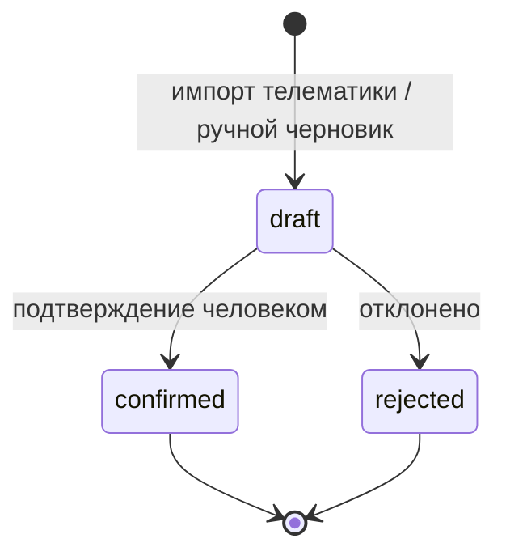
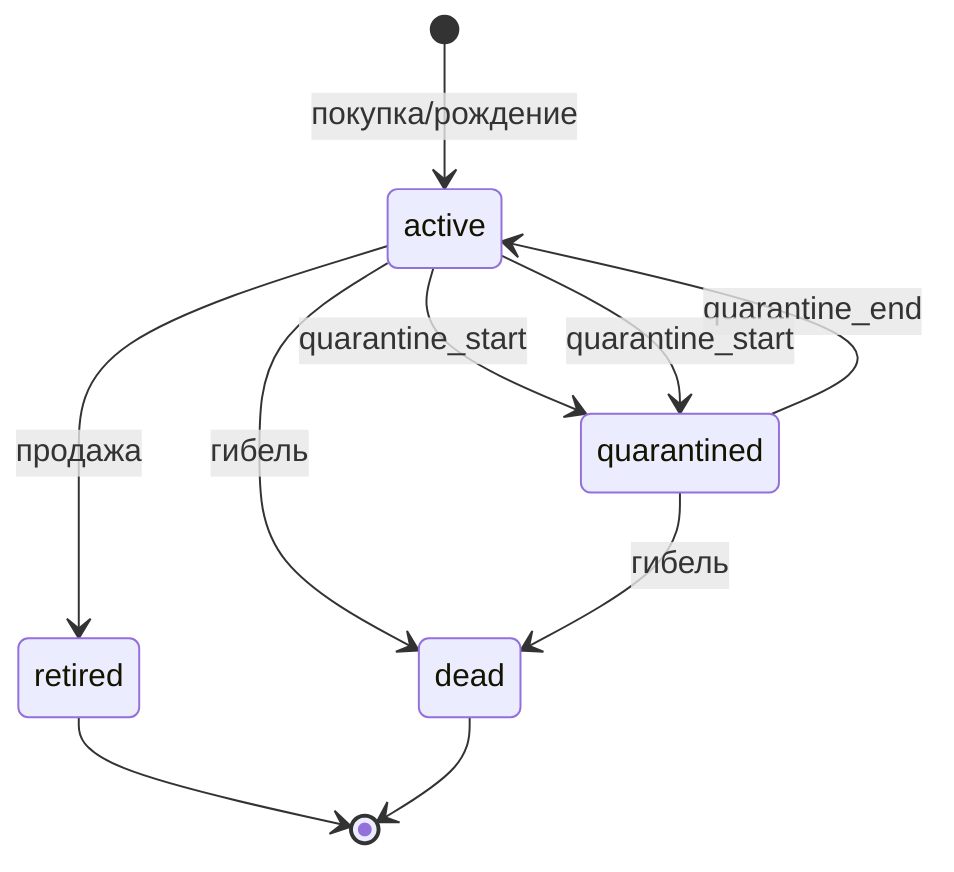

# Доменная модель: техника и животноводство

Статус: готово · Версия: 1.0 · Дата: 2026-11-05 · Автор: Иван Куликов

Опирается на docs/01-requirements.md (REQ-F-014..022, REQ-NF-006, SC-04, SC-05) и
CONTRACTS.md (§4–§6). Сущности агрономии (ENT-FIELD, ENT-FIELD-OPERATION и др.) —
в docs/03-domain-agronomy.md; здесь только техника и животноводство.

Формат сущности: ID | атрибуты (имя: тип — пояснение) | ограничения.
Типы: `uuid`, `string`, `int`, `decimal(x,y)`, `date`, `datetime`, `enum(...)`,
`geometry(Polygon)`, `uuid[]`. Единицы измерения — CONTRACTS §5.

## 1. Техника

### ENT-MACHINE — единица техники

| Атрибут | Тип | Ограничения/пояснение |
|---|---|---|
| machine_id | uuid | PK |
| machine_type | enum(tractor, combine, sprayer, spreader, seeder, truck, loader, other) | — |
| model | string | марка/модель |
| gov_number | string | госномер, уникален, nullable |
| width_m | decimal(5,2) | ширина захвата, м; >0 для tractor/seeder/sprayer/spreader |
| tank_capacity_l | int | ёмкость бака (для sprayer/spreader), л, nullable |
| engine_hours | decimal(10,1) | текущая наработка, моточасы |
| status | enum(active, maintenance, retired) | — |

### ENT-MACHINE-JOB — работа техники

| Атрибут | Тип | Ограничения/пояснение |
|---|---|---|
| job_id | uuid | PK |
| machine_id | uuid | FK → ENT-MACHINE |
| field_operation_id | uuid | FK → ENT-FIELD-OPERATION (03); nullable для внеполевых работ |
| performed_at | date | дата выполнения |
| area_ha | decimal(8,2) | фактическая обработанная площадь, га; ≥0 |
| fuel_l | decimal(8,1) | расход топлива, л; nullable |
| track_ref | string | ссылка на телематику-трек в хранилище; nullable |
| duration_h | decimal(5,2) | длительность, ч; nullable |
| status | enum(draft, confirmed, rejected) | draft — из телематики, подтверждается человеком |
| source | enum(manual, telemetry) | источник записи |

Телематика: трек — последовательность точек `{ts: datetime, lat, lon, speed_kmh}`;
импорт создаёт ENT-MACHINE-JOB в статусе draft с рассчитанной площадью (алгоритм:
буфер трека шириной захвата width_m → площадь; допустимое отклонение от эталона
≤5 %, REQ-F-016).

### ENT-MAINTENANCE — ТО и ремонты

| Атрибут | Тип | Ограничения/пояснение |
|---|---|---|
| maintenance_id | uuid | PK |
| machine_id | uuid | FK → ENT-MACHINE |
| kind | enum(service, repair, inspection) | — |
| due_at_hours | decimal(10,1) | плановая наработка по мото-часам |
| done_at | date | фактическая дата, nullable до выполнения |
| done_at_hours | decimal(10,1) | наработка на момент выполнения |
| downtime_h | decimal(6,1) | простой, ч |

### Бизнес-правила техники

| ID правила | Правило (проверяемо) | REQ/SC |
|---|---|---|
| RUL-TECH-01 | Запись ENT-MACHINE-JOB допускается, только если влажность почвы по ENT-WEATHER-OBSERVATION (сумма осадков за 48 ч) ≤ порога типа работы (посев/обработка — 5 мм, уборка — без лимита; пороги настраиваются) | REQ-F-015, SC-04 |
| RUL-TECH-02 | При engine_hours ≥ due_at_hours любого невыполненного ENT-MAINTENANCE создаётся ENT-ALERT (тип maintenance_due, за 10 моточасов до) | REQ-F-017 |
| RUL-TECH-03 | Общая обработанная площадь работ за день по машине ≤ width_m × средняя скорость × рабочие часы; превышение >20 % — пометка «подозрительная запись» на проверку | REQ-F-015 |
| RUL-TECH-04 | Из телематики создаётся только draft; статус confirmed присваивает механизатор/агроном (человек подтверждает факт) | REQ-F-016, SC-04 |
| RUL-TECH-05 | Простой >4 ч в сезон полевых работ (апрель–октябрь) по машине в статусе active без записи ENT-MAINTENANCE — ENT-ALERT (idle_machinery) | REQ-F-017 |

### Автомат статусов работы техники



## 2. Животноводство

### ENT-HERD / ENT-ANIMAL-GROUP — стадо и группы

| Атрибут | Тип | Ограничения/пояснение |
|---|---|---|
| group_id | uuid | PK группы |
| herd_id | uuid | FK стада (внутри хозяйства; стад одно или несколько) |
| name | string | «дойное стадо», «молодняк 0–6 мес», «откорм» |
| kind | enum(milking, dry, young, fattening, other) | технологический тип |
| headcount | int | расчётное поголовье; вычисляется из перемещений, не хранится вручную |

ENT-GROUP-MOVE — перемещение животных: `move_id: uuid, animal_ids: uuid[], from_group_id,
to_group_id, moved_at: date, reason: enum(age, production, veterinary, sale, purchase,
death)`. История группы строится только из перемещений.

### ENT-ANIMAL — животное

| Атрибут | Тип | Ограничения/пояснение |
|---|---|---|
| animal_id | uuid | PK |
| tag | string | идентификатор бирки; уникален |
| species | enum(cattle, sheep, pig, other) | вид |
| sex | enum(f, m) | — |
| birth_date | date | — |
| group_id | uuid | текущая группа, FK |
| production | decimal(6,1) | продуктивность: удой кг/сутки (f, cattle) или прирост г/сутки; периодическая запись ENT-PRODUCTION-RECORD: `{record_id, animal_id, at: date, kind: enum(milk, weight), value}` |
| status | enum(active, quarantined, retired, dead) | retired — выбытие из хозяйства |

### ENT-RATION — рацион кормления

| Атрибут | Тип | Ограничения/пояснение |
|---|---|---|
| ration_id | uuid | PK |
| group_id | uuid | FK; один активный рацион на группу на дату |
| valid_from | date | — |
| items | JSON | список кормов: `{feed_id: uuid (справочник), kg_per_head: decimal(6,2)}` |
| energy_ekе | decimal(5,2) | суммарная питательность, ЭКЕ/гол./сутки; вычисляется |
| protein_kg | decimal(5,3) | переваримый протеин, кг/гол./сутки; вычисляется |

Потребность хозяйства в кормах на период: `Σ по группам (поголовье × кг корма ×
дни периода)`; сопоставляется с плановым сбором кормовых культур севооборота
(ENT-CROP-CYCLE из 03, культуры с признаком forage) — связь SC-05.

### ENT-VET-EVENT — ветеринарное событие

| Атрибут | Тип | Ограничения/пояснение |
|---|---|---|
| vet_event_id | uuid | PK |
| animal_ids / group_id | uuid[] / uuid | событие по животным или группе (одно из двух не null) |
| kind | enum(vaccination, treatment, examination, quarantine_start, quarantine_end) | — |
| preparation | string | препарат/вакцина; nullable |
| withdrawal_days | int | срок ожидания продукции (молоко/мясо), дней; 0 если не применимо |
| event_date | date | — |

Выход навоза: ENT-MANURE-YIELD — `{group_id, period: месяц, manure_t: decimal(8,2),
n_kg, p_kg, k_kg}` (кг д.в. за период); передаётся в баланс удобрений mod-inputs
(03) как источник органики (REQ-F-022).

### Бизнес-правила животноводства

| ID правила | Правило (проверяемо) | REQ/SC |
|---|---|---|
| RUL-LIVE-01 | Перемещение животных запрещено (блокируется с пояснением), если хотя бы одно животное имеет status=quarantined | REQ-F-021, SC-05 |
| RUL-LIVE-02 | Продукция (надой) учитывается с пометкой «срок ожидания», если с даты ENT-VET-EVENT с withdrawal_days>0 прошло меньше срока ожидания | REQ-F-021 |
| RUL-LIVE-03 | Карантин снимается только событием quarantine_end с датой ≥ даты quarantine_start; между ними перемещения и ввод новых животных в группу запрещены | REQ-F-021 |
| RUL-LIVE-04 | Норма кормления: фактическая выдача корма группе за сутки не может отличаться от рациона более чем на 15 % без пометки «отклонение» с причиной | REQ-F-020 |
| RUL-LIVE-05 | Рацион обязан покрывать норму ЭКЕ/протеина по виду и продуктивности группы (справочник норм); расхождение >10 % — предупреждение при согласовании рациона | REQ-F-020, SC-05 |
| RUL-LIVE-06 | Молодняк переводится в следующую группу при достижении возрастной границы (по kind=young), система предлагает перемещение автоматически | REQ-F-018 |
| RUL-LIVE-07 | Гибель/выбытие животного закрывает его историю: после status=dead/retired новые записи продуктивности запрещены | REQ-F-019 |
| RUL-LIVE-08 | Выход навоза за период ≥ поголовье × норму выхода по виду (справочник); меньшее значение — пометка «проверить данные» | REQ-F-022 |

### Автоматы статусов

Животное:



## 3. Связи с доменом агрономии (03)

| Связь | Что передаёт | Направление |
|---|---|---|
| Кормовой баланс | потребность групп в кормах на период ↔ план кормовых культур | 04 → 03 (проверка плана), 03 → 04 (предложение культур) |
| Навоз как удобрение | ENT-MANURE-YIELD (N-P-K, кг д.в.) в баланс доз | 04 → 03 |
| Работа техники на поле | ENT-MACHINE-JOB ↔ ENT-FIELD-OPERATION | 04 ↔ 03 (job.field_operation_id) |
| Погода | осадки за 48 ч для RUL-TECH-01 | 05 → 04 |

## 4. Примеры JSON (CONTRACTS §5)

ENT-MACHINE-JOB:

```json
{
  "job_id": "9b2f6c1e-2f3a-4a5b-8c7d-0e1f2a3b4c5d",
  "machine_id": "1a2b3c4d-0000-4000-8000-abcdefabcdef",
  "field_operation_id": "5c6d7e8f-0000-4000-8000-abcdefabcdef",
  "performed_at": "2026-05-18",
  "area_ha": 48.5,
  "fuel_l": 132.0,
  "track_ref": "tracks/2026/05/18/9b2f6c1e.geojson",
  "duration_h": 7.5,
  "status": "confirmed",
  "source": "telemetry"
}
```

ENT-RATION (фрагмент):

```json
{
  "ration_id": "7d8e9f0a-0000-4000-8000-abcdefabcdef",
  "group_id": "3c4d5e6f-0000-4000-8000-abcdefabcdef",
  "valid_from": "2026-06-01",
  "items": [
    {"feed_id": "aa11bb22-0000-4000-8000-abcdefabcdef", "kg_per_head": 22.0},
    {"feed_id": "bb22cc33-0000-4000-8000-abcdefabcdef", "kg_per_head": 4.5}
  ],
  "energy_eke": 18.5,
  "protein_kg": 2.1
}
```

## 5. Параметры по умолчанию (конфигурируемые)

| Параметр | Значение по умолчанию |
|---|---|
| Порог осадков за 48 ч для полевых работ | 5 мм (посев/обработка), без лимита (уборка) |
| Предупреждение ТО | за 10 моточасов до due_at_hours |
| Порог «подозрительной записи» площади | +20 % от теоретической производительности |
| Допустимое отклонение выдачи кормов | ±15 % от рациона |
| Допустимое расхождение рациона с нормами ЭКЕ/протеина | 10 % |

Справочники (нормы кормления, нормы выхода навоза, возрастные границы групп,
совместимость препаратов) — DAT-таблицы, определяются в docs/06-data-api.md.
