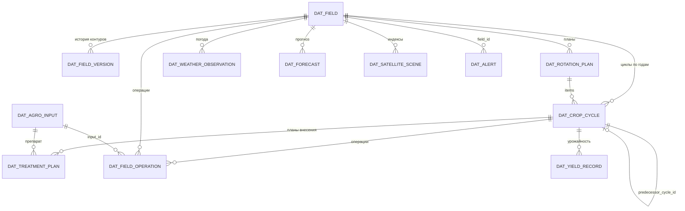
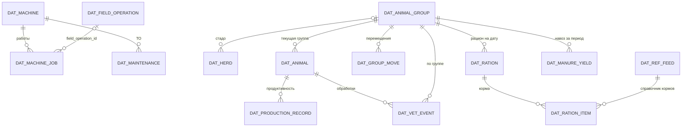
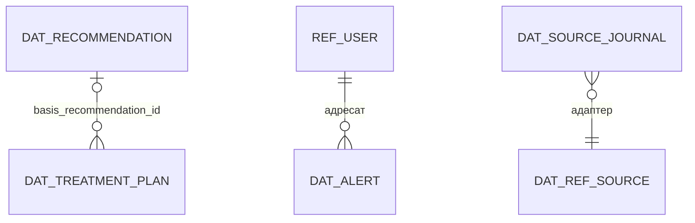

# Модель данных и REST API ЦДА

Статус: готово · Версия: 1.2 · Дата: 2026-11-06 · Автор: Иван Куликов

Опирается на CONTRACTS.md (§4–§6, §8), docs/03-domain-agronomy.md (ENT, RULE-AGRO),
docs/04-domain-farm.md (ENT, RULE-TECH/LIVE) и docs/05-integrations.md (IF, нормализованные
структуры). Таблица хранится в PostgreSQL 18 + PostGIS (ADR-02); геометрия контуров —
тип geometry(Polygon, 4326), площадь вычисляется в равновеликой проекции (03 §1.1).

Правила именования таблиц: `dat_<сущность>`; справочники — `ref_<имя>`; во внешнем API
ID сущностей указаны в трассировке (§6). Все таблицы имеют `id UUID PK`, `created_at`,
`updated_at` (03 §1) — в таблицах ниже не повторяются.

## 1. ER-модель (ядро)

Диаграмма разбита на три фрагмента для читаемости; связи между фрагментами — через
field_id / cycle_id.

### 1.1. Агрономия



### 1.2. Техника и животноводство



### 1.3. Сквозные



## 2. Таблицы DAT

Атрибуты сущностей повторяют определения 03/04/05 (документы-владельцы); ниже —
состав ключей и отличия хранения.

| Таблица | Сущность (владелец) | Ключи/индексы | Особенности |
|---|---|---|---|
| dat_field | ENT-FIELD (03) | UQ(name); GIST(contour) | area_ga — generated column; version_id текущая |
| dat_field_version | ENT-FIELD.versions (03) | UQ(field_id, version_no) | contour, area_ga, valid_from, reason |
| dat_rotation_plan | ENT-ROTATION-PLAN (03) | UQ(field_id, year_from, year_to) при status != archived | — |
| dat_crop_cycle | ENT-CROP-CYCLE (03) | UQ(field_id, year, kind=main) — RULE-AGRO-04 | FK culture → ref_culture |
| dat_agro_input | ENT-AGRO-INPUT (03) | UQ(kind, name) | — |
| dat_treatment_plan | ENT-TREATMENT-PLAN (03) | IX(cycle_id, status) | — |
| dat_field_operation | ENT-FIELD-OPERATION (03) | IX(field_id, date); IX(cycle_id) | — |
| dat_yield_record | ENT-YIELD-RECORD (03) | UQ(cycle_id, date, source) | — |
| dat_alert | ENT-ALERT (03) | IX(status, user_id); IX(type) | — |
| dat_recommendation | ENT-RECOMMENDATION (03) | IX(status); IX(target_type, target_id) | — |
| dat_machine | ENT-MACHINE (04) | UQ(gov_number) где не null | — |
| dat_machine_job | ENT-MACHINE-JOB (04) | IX(machine_id, performed_at); FK field_operation_id | track_ref — ссылка в объектное хранилище |
| dat_maintenance | ENT-MAINTENANCE (04) | IX(machine_id, done_at) | — |
| dat_herd | ENT-HERD (04) | UQ(name) | — |
| dat_animal_group | ENT-ANIMAL-GROUP (04) | UQ(herd_id, name) | headcount — view по dat_group_move |
| dat_animal | ENT-ANIMAL (04) | UQ(tag) | — |
| dat_group_move | ENT-GROUP-MOVE (04) | IX(from_group_id), IX(to_group_id), IX(moved_at) | animal_ids — FK[] |
| dat_production_record | ENT-PRODUCTION-RECORD (04) | IX(animal_id, at) | — |
| dat_ration / dat_ration_item | ENT-RATION (04) | UQ(group_id, valid_from); FK feed_id → ref_feed | energy_eke, protein_kg — вычисляются |
| dat_vet_event | ENT-VET-EVENT (04) | IX(event_date); (animal_ids NOT NULL) XOR (group_id NOT NULL) | CHECK-ограничение |
| dat_manure_yield | ENT-MANURE-YIELD (04) | UQ(group_id, period_month) | n_kg/p_kg/k_kg, кг д.в. |
| dat_weather_observation | ENT-WEATHER-OBSERVATION (05) | UQ(field_id, observed_at, source_id) — дедупликация | — |
| dat_forecast | ENT-FORECAST (05) | UQ(field_id, forecast_for) | последняя версия перезаписывает |
| dat_satellite_scene | ENT-SATELLITE-SCENE (05) | UQ(field_id, index, captured_at, source_id) | cloud_pct > 60 не сохраняется (05 §5) |
| dat_source_journal | журнал состояний адаптеров (05 §6, REQ-F-034) | IX(source_id, at) | события ok/degraded/error + причина; текущий статус — в ref_source |

## 3. Справочники ref_ и нормативы

| Таблица | Содержание | Связь с требованиями |
|---|---|---|
| ref_culture | культуры: name, kind (main/forage/catch), forage_flag, crop_group, repeat_years, color_hex (varchar(7), CSS-цвет для карты) | севооборот; кормовой баланс SC-05; карта v1 #55 |
| ref_predecessor_matrix | совместимость пар культур (RULE-AGRO-01): culture_id, predecessor_id, verdict (ok/warn/ban) | REQ-F-006 |
| ref_nutrient_norm | вынос N-P-K культурой (кг д.в./ц), возврат лет по культуре, лимиты доз — редактируемый справочник с полем source (REC-19) | REQ-F-011 |
| ref_agrochem | результаты агрохимии: field_id, sample_date, ph, humus_pct, n_mg100, p2o5_mg100, k2o_mg100 | REQ-F-004, 031 |
| ref_feed | корма: name, energy_eke_per_kg, protein_pct, dry_matter_pct | REQ-F-020 |
| ref_feeding_norm | нормы кормления по kind группы (ЭКЕ, протеин) — RULE-LIVE-05 | REQ-F-020 |
| ref_manure_norm | выход навоза и д.в. на голову по виду — RULE-LIVE-08 | REQ-F-022 |
| ref_price | цена: item_type (crop/input; пост-MVP v2: +feed/product — 12-economics.md §3.3, §4), item_id, price_rub, date, source_id | REQ-F-033 |
| ref_source | адаптеры: source_id, kind, enabled, last_status, last_success_at | REQ-F-034 |
| ref_user / ref_role | пользователи и роли (01 §2); пароли — только хеш (REQ-NF-005) | матрица прав 07-ux |
| ref_weather_rule | параметры погодных окон по operation_type (RULE-AGRO-09) | REQ-F-025 |

## 4. Версионирование и аудит

- История контуров полей — dat_field_version (03 §1.1): операции привязаны к версии,
  действовавшей на дату операции [REQ-F-002].
- Версии планов: dat_treatment_plan и dat_rotation_plan не переписываются — переходы
  статусов по автоматам 03 §2; аудиторская таблица dat_audit: `id, entity, entity_id,
  user_id, action (create/update/status_change), changed JSONB, at` — все критичные
  действия (согласование планов, правки справочников, подтверждение работ) [REQ-NF-005].
- Прогнозы погоды не версионируются: dat_forecast хранит последнюю актуальную версию
  на горизонт 7 суток (05 §3).

## 5. REST API /api/v1

Конвенции — CONTRACTS §8: JSON snake_case, пагинация `?limit&offset`, обёртка
`{"items", "total", "limit", "offset"}`, ошибки RFC 7807. Пример постраничного ответа
(`GET /api/v1/fields?limit=2&offset=0` → 200):

```json
{"items": [{"field_id": "0b2a5b0e-6f3f-4e5c-9b1d-7f4a1c2d3e01", "name": "Степное-7",
  "area_ga": 84.53, "status": "active"}],
 "total": 17, "limit": 2, "offset": 0}
```

| API | Метод и путь | Назначение | REQ/SC |
|---|---|---|---|
| API-01 | GET /fields | список полей (фильтры status, q по имени); элементы содержат агрегат current_cycle {year, culture_name, kind} \| null; параметр with_geometry=true добавляет contour (по умолчанию опущен — экономия трафика; карта запрашивает с ним) | REQ-F-003 |
| API-02 | POST /fields | создать поле с контуром | REQ-F-001 |
| API-03 | PATCH /fields/{id} | правка (смена контура создаёт версию) | REQ-F-002 |
| API-04 | POST /fields/import | импорт GeoJSON/KML, отчёт ImportReport | REQ-F-001 |
| API-05 | GET /fields/{id} | карточка «Поле 360°»: агрегат поля, NDVI, погода, журнал | REQ-F-003, SC-01 |
| API-06 | GET /fields/{id}/ndvi | таймлайн индексов с датами и cloud_pct | REQ-F-028 |
| API-07 | GET /fields/{id}/weather | факты + прогноз 7 сут | REQ-F-023, 024 |
| API-08 | GET /rotation-plans; GET /rotation-plans/{id}/violations | планы севооборота; пересчёт нарушений RULE-AGRO-01/03/04 по требованию без записи (формат — §7.2) | REQ-F-005 |
| API-09 | POST /rotation-plans | создать план; ответ содержит список нарушений | REQ-F-005, SC-01 |
| API-10 | POST /rotation-plans/{id}/approve | согласование руководителем | REQ-F-005, SC-01 |
| API-11 | POST /crop-cycles | добавить цикл; 422 при нарушении RULE-AGRO-01/03/04 | REQ-F-006, 007 |
| API-12 | GET /recommendations | рекомендации (фильтр status) | REQ-F-011, 030 |
| API-13 | POST /recommendations/{id}/accept | принять → черновик плана | SC-02 |
| API-14 | GET /agro-inputs, POST /agro-inputs | справочник препаратов | REQ-F-009 |
| API-15 | GET /treatment-plans, POST /treatment-plans | планы внесения (422 — RULE-AGRO-07/08/10); для type=spraying в ответе POST — объект weather_window (WEATHER-WINDOW, §7.2) | REQ-F-010, SC-02 |
| API-16 | POST /treatment-plans/{id}/approve | согласование; для spraying также возвращает weather_window (§7.2) | SC-02 |
| API-17 | POST /operations | запись факта операции (мобильный, офлайн-очередь); опциональное поле запроса client_id (uuid) — идемпотентность офлайн-очереди: повтор с тем же client_id возвращает существующую операцию (200, без дубля); RULE-AGRO-12: если actual_area_ga > 1,05 × area_ga поля по последней версии контура — операция СОХРАНЯЕТСЯ с needs_review=true (не 422, «факт важнее плана») | REQ-F-013, SC-03 |
| API-18 | GET /operations?field_id&date_from&date_to | журнал операций | SC-03 |
| API-19 | GET /machines, POST /machines; GET /machines/{id}/jobs | парк техники и задания машины | REQ-F-014 |
| API-20 | GET /machine-jobs (фильтр status, пагинация items/total/limit/offset), POST /machine-jobs (создаёт draft, source=manual/telemetry), PATCH /machine-jobs/{id} (draft→confirmed/rejected, прочие — 409), POST /machine-jobs/{id}/confirm | задания смен: список, черновики и подтверждение (RULE-TECH-04) | REQ-F-015, F-016, SC-04 |
| API-21 | GET /maintenance, POST /maintenance | ТО и ремонты | REQ-F-017 |
| API-22 | GET /groups, POST /groups | группы животных | REQ-F-018 |
| API-23 | POST /group-moves | перемещение; 422 при карантине (RULE-LIVE-01) | REQ-F-018 |
| API-24 | GET /animals, POST /animals | животные | REQ-F-019 |
| API-25 | GET /rations, POST /rations | рационы (422 — RULE-LIVE-05) | REQ-F-020 |
| API-26 | GET /vet-events, POST /vet-events | ветсобытия | REQ-F-021 |
| API-27 | GET /alerts (фильтры status/type/field_id, пагинация), POST /alerts/{id}/read, PATCH /alerts/{id} {status} (new→read→closed, неверный переход — 409) | оповещения пользователя | REQ-F-026, 034 |
| API-28 | GET /sources/status | журнал адаптеров (источник, статус, last_success_at) | REQ-F-034 |
| API-29 | GET /weather/forecast?field_id&days | прогноз (кэш 3 ч) | REQ-F-024 |
| API-30 | POST /imports/soil | импорт агрохимии → ImportReport | REQ-F-031 |
| API-31 | POST /imports/telemetry | импорт CSV/ISOXML → черновики работ | REQ-F-016, 032 |
| API-32 | GET /export?entity= | экспорт доменных таблиц JSON/CSV | REQ-NF-007 |
| API-33 | POST /ai/chat | диалог ИИ-ассистента по данным хозяйства (ответ + refs) | REQ-F-035 |
| API-34 | POST /ai/explain | объяснение рекомендации по rationale/data_refs | REQ-F-037 |
| API-35 | POST /ai/summary | сводка журнала/алертов за период | REQ-F-038 |
| API-46 | POST /auth/login | аутентификация: {login, password} → {token, user {name, role, farm_name}}; ошибки 401 code=bad_credentials | 01 §2 |
| API-47 | GET /auth/me | текущий пользователь по JWT → {id, name, role} | 01 §2 |
| API-48 | GET /references/cultures | справочник культур: фильтры crop_group, q; элементы — name, kind, forage_flag, crop_group, repeat_years, color_hex; группа прав «references» (07-ux §5, экран E-15) | REQ-F-006; карта v1 #55 |
| API-49 | GET /fields/{id}/crop-cycles?year_from&year_to | история севооборота поля: items {year, culture_id, culture_name, kind, status, color_hex} по убыванию года; без фильтров — все годы; права как у карточки поля (API-05) | REQ-F-005, 006; v1 «история по полям» |

Пост-MVP (описаны в своих документах, здесь — только индекс): API-36..39 —
агроскаутинг (docs/11-agroscouting.md §5), API-40..45 — экономика
(docs/12-economics.md §5). Формат пути и ошибок — настоящие §5 и §8 CONTRACTS.

Пример ошибки 422 — нарушение бизнес-правила (`POST /api/v1/treatment-plans`):

```json
{"type": "https://cda.example/errors/waiting-period",
 "title": "Нарушено бизнес-правило", "status": 422,
 "detail": "Срок ожидания препарата 20 дней, до плановой уборки 3 дня (RULE-AGRO-08)",
 "rule_id": "RULE-AGRO-08", "entity": "treatment_plan"}
```

Пример успешного создания (`POST /api/v1/operations` → 201, заголовок
`Location: /api/v1/operations/f1e2...c901`):

```json
{"operation_id": "f1e2d3c4-0a9b-4c8d-8e7f-a1b2c3d4e5f6",
 "field_id": "0b2a5b0e-6f3f-4e5c-9b1d-7f4a1c2d3e01",
 "operation_type": "spraying", "date": "2026-06-10",
 "input_id": "3d4e5f6a-0000-4000-8000-abcdefabcdef", "actual_dose": 2.0,
 "actual_area_ga": 82.10, "performer": "Петров И.", "source": "manual",
 "deviation_flag": false, "status": "done"}
```

## 6. Трассировка ENT/IF → DAT → API

| ENT / IF | DAT | API |
|---|---|---|
| ENT-FIELD (+versions) | dat_field, dat_field_version | API-01..05 |
| ENT-ROTATION-PLAN / ENT-CROP-CYCLE | dat_rotation_plan, dat_crop_cycle | API-08..11 |
| ENT-AGRO-INPUT | dat_agro_input | API-14 |
| ENT-TREATMENT-PLAN | dat_treatment_plan | API-15, 16 |
| ENT-FIELD-OPERATION | dat_field_operation | API-17, 18 |
| ENT-YIELD-RECORD | dat_yield_record | API-17 (внутри операции уборки), API-05 |
| ENT-ALERT / ENT-RECOMMENDATION | dat_alert, dat_recommendation | API-12, 13, 27 |
| ENT-MACHINE / ENT-MACHINE-JOB / ENT-MAINTENANCE | dat_machine, dat_machine_job, dat_maintenance | API-19..21 |
| ENT-HERD, ENT-ANIMAL-GROUP, ENT-GROUP-MOVE, ENT-ANIMAL, ENT-PRODUCTION-RECORD | dat_herd, dat_animal_group, dat_group_move, dat_animal, dat_production_record | API-22..24 |
| ENT-RATION | dat_ration(+item) | API-25 |
| ENT-VET-EVENT, ENT-MANURE-YIELD | dat_vet_event, dat_manure_yield | API-26, (manure — внутри отчёта кормового баланса SC-05) |
| ENT-WEATHER-OBSERVATION / ENT-FORECAST | dat_weather_observation, dat_forecast | API-07, 29 |
| ENT-SATELLITE-SCENE | dat_satellite_scene | API-06 |
| IF-SOIL (импорт) | ref_agrochem | API-30 |
| IF-TELEMETRY (импорт) | dat_machine_job (draft) | API-31, 20 |
| IF-WEATHER / IF-SATELLITE / IF-PRICES (состояние адаптеров) | ref_source, dat_source_journal | API-28 |
| справочники/нормативы (REC-19) | ref_* (§3) | API-14, 22..26 + админ-экраны E-* |

## 7. Открытые вопросы

- Формат админ-API справочников ref_nutrient_norm / ref_predecessor_matrix (CRUD или
  массовый импорт) — зафиксировать при старте реализации MVP.
- Расширение GET /export форматами (только JSON/CSV в MVP) — по REQ-NF-007.

### 7.1. Отложенные расширения v1 (backlog, по итогам интеграционной приёмки MVP, #41)

Выявлены при сквозной приёмке фронтенда на реальном API; не входят в MVP,
приняты в backlog v1 (решение зафиксировано в обсуждении #41, пост #135):

- API-08: пересчёт violations по требованию, без записи цикла —
  GET /rotation-plans/{id}/violations (или ?recalculate=true). В MVP violations
  возвращаются только при POST (dry-run/422).
- Справочник культур: GET /cultures над ref_culture (в MVP культуры выводятся
  из циклов планов).
- API-05: полный агрегат «Поле 360°» (agrochem, rotation_check, treatment_plans)
  одним ответом; в MVP карточка композитится из API-08/API-15 на клиенте.
- API-29: precip_prob_pct (вероятность осадков) — добавить при выборе
  финального погодного провайдера (см. docs/05).
