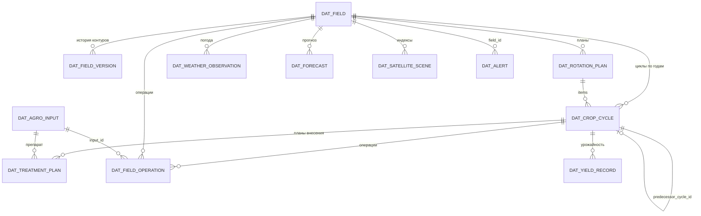
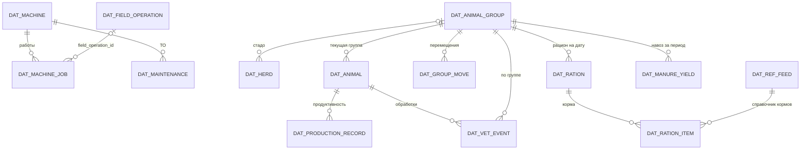
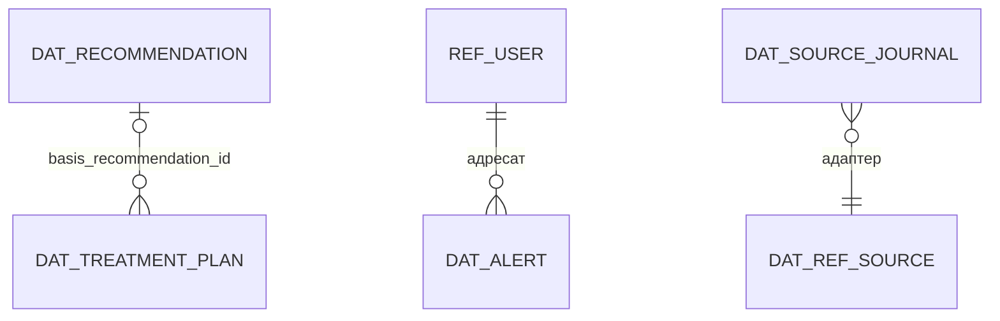

# Модель данных и REST API ЦДА

Статус: готово · Версия: 1.8 · Дата: 2026-11-08 · Автор: Иван Куликов

Опирается на CONTRACTS.md (§4–§6, §8), docs/03-domain-agronomy.md (ENT, RULE-AGRO),
docs/04-domain-farm.md (ENT, RULE-TECH/LIVE) и docs/05-integrations.md (IF, нормализованные
структуры). Таблица хранится в PostgreSQL 18 + PostGIS (ADR-02); геометрия контуров —
тип geometry(Polygon, 4326), площадь вычисляется в равновеликой проекции (03 §1.1).

Правила именования таблиц: `dat_<сущность>`; справочники — `ref_<имя>`; во внешнем API
ID сущностей указаны в трассировке (§6). Все таблицы имеют `id UUID PK`, `created_at`,
`updated_at` (03 §1) — в таблицах ниже не повторяются.

## 1. ER-модель (ядро)

Диаграмма разбита на три фрагмента для читаемости; связи между фрагментами — через
field_id / cycle_id.

### 1.1. Агрономия



### 1.2. Техника и животноводство



### 1.3. Сквозные



## 2. Таблицы DAT

Атрибуты сущностей повторяют определения 03/04/05 (документы-владельцы); ниже —
состав ключей и отличия хранения.

| Таблица | Сущность (владелец) | Ключи/индексы | Особенности |
|---|---|---|---|
| dat_field | ENT-FIELD (03) | UQ(name); GIST(contour) | area_ga — generated column; version_id текущая |
| dat_field_version | ENT-FIELD.versions (03) | UQ(field_id, version_no) | contour, area_ga, valid_from, reason |
| dat_rotation_plan | ENT-ROTATION-PLAN (03) | UQ(field_id, year_from, year_to) при status != archived | — |
| dat_crop_cycle | ENT-CROP-CYCLE (03) | UQ(field_id, year, kind=main) — RULE-AGRO-04 | FK culture → ref_culture |
| dat_agro_input | ENT-AGRO-INPUT (03) | UQ(kind, name) | — |
| dat_treatment_plan | ENT-TREATMENT-PLAN (03) | IX(cycle_id, status) | — |
| dat_field_operation | ENT-FIELD-OPERATION (03) | IX(field_id, date); IX(cycle_id) | — |
| dat_yield_record | ENT-YIELD-RECORD (03) | UQ(cycle_id, date, source) | — |
| dat_alert | ENT-ALERT (03) | IX(status, user_id); IX(type) | — |
| dat_recommendation | ENT-RECOMMENDATION (03) | IX(status); IX(target_type, target_id) | — |
| dat_machine | ENT-MACHINE (04) | UQ(gov_number) где не null | — |
| dat_machine_job | ENT-MACHINE-JOB (04) | IX(machine_id, performed_at); FK field_operation_id | track_ref — ссылка в объектное хранилище |
| dat_maintenance | ENT-MAINTENANCE (04) | IX(machine_id, done_at) | — |
| dat_herd | ENT-HERD (04) | UQ(name) | — |
| dat_animal_group | ENT-ANIMAL-GROUP (04) | UQ(herd_id, name) | headcount — view по dat_group_move |
| dat_animal | ENT-ANIMAL (04) | UQ(tag) | — |
| dat_group_move | ENT-GROUP-MOVE (04) | IX(from_group_id), IX(to_group_id), IX(moved_at) | animal_ids — FK[] |
| dat_production_record | ENT-PRODUCTION-RECORD (04) | IX(animal_id, at) | — |
| dat_ration / dat_ration_item | ENT-RATION (04) | UQ(group_id, valid_from); FK feed_id → ref_feed | energy_eke, protein_kg — вычисляются |
| dat_vet_event | ENT-VET-EVENT (04) | IX(event_date); (animal_ids NOT NULL) XOR (group_id NOT NULL) | CHECK-ограничение |
| dat_manure_yield | ENT-MANURE-YIELD (04) | UQ(group_id, period_month) | n_kg/p_kg/k_kg, кг д.в. |
| dat_weather_observation | ENT-WEATHER-OBSERVATION (05) | UQ(field_id, observed_at, source_id) — дедупликация | — |
| dat_forecast | ENT-FORECAST (05) | UQ(field_id, forecast_for) | последняя версия перезаписывает |
| dat_satellite_scene | ENT-SATELLITE-SCENE (05) | UQ(field_id, index, captured_at, source_id) | cloud_pct > 60 не сохраняется (05 §5) |
| dat_source_journal | журнал состояний адаптеров (05 §6, REQ-F-034) | IX(source_id, at) | события ok/degraded/error + причина; текущий статус — в ref_source |

## 3. Справочники ref_ и нормативы

| Таблица | Содержание | Связь с требованиями |
|---|---|---|
| ref_culture | культуры: name, kind (main/forage/catch), forage_flag, crop_group, repeat_years, color_hex (varchar(7), CSS-цвет для карты) | севооборот; кормовой баланс SC-05; карта v1 #55 |
| ref_predecessor_matrix | совместимость пар культур (RULE-AGRO-01): culture_id, predecessor_id, verdict (ok/warn/ban) | REQ-F-006 |
| ref_nutrient_norm | вынос N-P-K культурой (кг д.в./ц), возврат лет по культуре, лимиты доз — редактируемый справочник с полем source (REC-19) | REQ-F-011 |
| ref_agrochem | результаты агрохимии: field_id, sample_date, ph, humus_pct, n_mg100, p2o5_mg100, k2o_mg100 | REQ-F-004, 031 |
| ref_feed | корма: name, energy_eke_per_kg, protein_pct, dry_matter_pct | REQ-F-020 |
| ref_feeding_norm | нормы кормления по kind группы (ЭКЕ, протеин) — RULE-LIVE-05 | REQ-F-020 |
| ref_manure_norm | выход навоза и д.в. на голову по виду — RULE-LIVE-08 | REQ-F-022 |
| ref_price | цена: item_type (crop/input; пост-MVP v2: +feed/product — 12-economics.md §3.3, §4), item_id, price_rub, date, source_id | REQ-F-033 |
| ref_source | адаптеры: source_id, kind, enabled, last_status, last_success_at | REQ-F-034 |
| ref_user / ref_role | пользователи и роли (01 §2); пароли — только хеш (REQ-NF-005) | матрица прав 07-ux |
| ref_weather_rule | параметры погодных окон по operation_type (RULE-AGRO-09) | REQ-F-025 |

## 4. Версионирование и аудит

- История контуров полей — dat_field_version (03 §1.1): операции привязаны к версии,
  действовавшей на дату операции [REQ-F-002].
- Версии планов: dat_treatment_plan и dat_rotation_plan не переписываются — переходы
  статусов по автоматам 03 §2; аудиторская таблица dat_audit: `id, entity, entity_id,
  user_id, action (create/update/status_change), changed JSONB, at` — все критичные
  действия (согласование планов, правки справочников, подтверждение работ) [REQ-NF-005].
- Прогнозы погоды не версионируются: dat_forecast хранит последнюю актуальную версию
  на горизонт 7 суток (05 §3).

## 5. REST API /api/v1

Конвенции — CONTRACTS §8: JSON snake_case, пагинация `?limit&offset`, обёртка
`{"items", "total", "limit", "offset"}`, ошибки RFC 7807. Пример постраничного ответа
(`GET /api/v1/fields?limit=2&offset=0` → 200):

```json
{"items": [{"field_id": "0b2a5b0e-6f3f-4e5c-9b1d-7f4a1c2d3e01", "name": "Степное-7",
  "area_ga": 84.53, "status": "active"}],
 "total": 17, "limit": 2, "offset": 0}
```

| API | Метод и путь | Назначение | REQ/SC |
|---|---|---|---|
| API-01 | GET /fields | список полей (фильтры status, q по имени); элементы содержат агрегат current_cycle {year, culture_name, kind} \| null; параметр with_geometry=true добавляет contour (по умолчанию опущен — экономия трафика; карта запрашивает с ним) | REQ-F-003 |
| API-02 | POST /fields | создать поле с контуром | REQ-F-001 |
| API-03 | PATCH /fields/{id} | правка (смена контура создаёт версию) | REQ-F-002 |
| API-04 | POST /fields/import | импорт GeoJSON/KML, отчёт ImportReport | REQ-F-001 |
| API-05 | GET /fields/{id} | карточка «Поле 360°»: агрегат поля, NDVI, погода, журнал | REQ-F-003, SC-01 |
| API-06 | GET /fields/{id}/ndvi | таймлайн индексов с датами и cloud_pct | REQ-F-028 |
| API-07 | GET /fields/{id}/weather | факты + прогноз 7 сут; каждый день прогноза содержит hazards — опасные явления (§7.8, #139) | REQ-F-023, 024 |
| API-08 | GET /rotation-plans; GET /rotation-plans/{id}/violations | планы севооборота; пересчёт нарушений RULE-AGRO-01/03/04 по требованию без записи (формат — §7.2) | REQ-F-005 |
| API-09 | POST /rotation-plans | создать план; ответ содержит список нарушений | REQ-F-005, SC-01 |
| API-10 | POST /rotation-plans/{id}/approve | согласование руководителем | REQ-F-005, SC-01 |
| API-11 | POST /crop-cycles | добавить цикл; 422 при нарушении RULE-AGRO-01/03/04 | REQ-F-006, 007 |
| API-12 | GET /recommendations | рекомендации (фильтр status) | REQ-F-011, 030 |
| API-13 | POST /recommendations/{id}/accept | принять → черновик плана | SC-02 |
| API-14 | GET /agro-inputs, POST /agro-inputs | справочник препаратов | REQ-F-009 |
| API-15 | GET /treatment-plans, POST /treatment-plans | планы внесения (422 — RULE-AGRO-07/08/10); для type=spraying в ответе POST — объект weather_window (WEATHER-WINDOW, §7.2) | REQ-F-010, SC-02 |
| API-16 | POST /treatment-plans/{id}/approve | согласование; для spraying также возвращает weather_window (§7.2) | SC-02 |
| API-17 | POST /operations | запись факта операции (мобильный, офлайн-очередь); опциональное поле запроса client_id (uuid) — идемпотентность офлайн-очереди: повтор с тем же client_id возвращает существующую операцию (200, без дубля); RULE-AGRO-12: если actual_area_ga > 1,05 × area_ga поля по последней версии контура — операция СОХРАНЯЕТСЯ с needs_review=true (не 422, «факт важнее плана») | REQ-F-013, SC-03 |
| API-18 | GET /operations?field_id&date_from&date_to | журнал операций | SC-03 |
| API-19 | GET /machines, POST /machines; GET /machines/{id}/jobs | парк техники и задания машины | REQ-F-014 |
| API-20 | GET /machine-jobs (фильтр status, пагинация items/total/limit/offset), POST /machine-jobs (создаёт draft, source=manual/telemetry), PATCH /machine-jobs/{id} (draft→confirmed/rejected, прочие — 409), POST /machine-jobs/{id}/confirm | задания смен: список, черновики и подтверждение (RULE-TECH-04) | REQ-F-015, F-016, SC-04 |
| API-21 | GET /maintenance, POST /maintenance | ТО и ремонты | REQ-F-017 |
| API-22 | GET /groups, POST /groups | группы животных | REQ-F-018 |
| API-23 | POST /group-moves | перемещение; 422 при карантине (RULE-LIVE-01) | REQ-F-018 |
| API-24 | GET /animals, POST /animals | животные | REQ-F-019 |
| API-25 | GET /rations, POST /rations | рационы (422 — RULE-LIVE-05) | REQ-F-020 |
| API-26 | GET /vet-events, POST /vet-events | ветсобытия | REQ-F-021 |
| API-27 | GET /alerts (фильтры status/type/field_id, пагинация), POST /alerts/{id}/read, PATCH /alerts/{id} {status} (new→read→closed, неверный переход — 409) | оповещения пользователя | REQ-F-026, 034 |
| API-28 | GET /sources/status | журнал адаптеров (источник, статус, last_success_at) | REQ-F-034 |
| API-29 | GET /weather/forecast?field_id&days | прогноз (кэш 3 ч); каждый день содержит precip_prob_pct int 0–100 \| null (§7.2) и hazards — опасные явления (§7.8, #139); поле также входит в агрегат API-07 | REQ-F-024 |
| API-30 | POST /imports/soil | импорт агрохимии → ImportReport | REQ-F-031 |
| API-31 | POST /imports/telemetry | импорт CSV/ISOXML → черновики работ | REQ-F-016, 032 |
| API-32 | GET /export?entity= | экспорт доменных таблиц JSON/CSV | REQ-NF-007 |
| API-33 | POST /ai/chat | диалог ИИ-ассистента по данным хозяйства (ответ + refs) | REQ-F-035 |
| API-34 | POST /ai/explain | объяснение рекомендации по rationale/data_refs | REQ-F-037 |
| API-35 | POST /ai/summary | сводка журнала/алертов за период | REQ-F-038 |
| API-46 | POST /auth/login | аутентификация: {login, password} → {token, user {name, role, farm_name}}; ошибки 401 code=bad_credentials | 01 §2 |
| API-47 | GET /auth/me | текущий пользователь по JWT → {id, name, role} | 01 §2 |
| API-48 | GET /references/cultures | справочник культур: фильтры crop_group, q; элементы — name, kind, forage_flag, crop_group, repeat_years, color_hex; группа прав «references» (07-ux §5, экран E-15) | REQ-F-006; карта v1 #55 |
| API-49 | GET /fields/{id}/crop-cycles?year_from&year_to | история севооборота поля: items {year, culture_id, culture_name, kind, status, color_hex} по убыванию года; без фильтров — все годы; права как у карточки поля (API-05) | REQ-F-005, 006; v1 «история по полям» |
| API-50 | GET /fields/{id}/ndvi/{date}/render.png?variant=ndvi\|truecolor\|ndwi | PNG-рендер сцены на контуре поля (§7.3 NDVI/true-color, §7.4 NDWI-вымокания); заголовки X-Field-Bbox/X-Image-Size; 404 если сцены с рендером нет; кэш immutable | REQ-F-028 |
| API-51 | GET /fields/{id}/insights | «Выводы ассистента» в карточке поля: числовые детекторы (всегда) + LLM-сводка при доступном Ollama (§7.4; 09-ai §8.2), source=rules+llm\|rules | REQ-F-035, 037 |
| API-52 | GET /fields/{id}/vra; GET /fields/{id}/vra/map.png | зоны дифференцированного внесения всегда при наличии чистых сцен (3 зоны по перцентилям NDVI) и карта зон PNG; метрики однородности iqr_ndvi/spatial_spread; 422 только vra_no_season_data (§7.4 v1.7) | REQ-F-010 |
| API-53 | GET /fields/{id}/yield-forecast | оценка урожайности по кривой NDVI (эмпирика, интервал ±25 %, §7.4; 09-ai §8.3); 422 yield_no_season_data/yield_no_culture/yield_no_model | REQ-F-028 |
| API-54 | GET /fields/{id}/seasons | список сезонов NDVI поля (годы, счётчики сцен, культура цикла; §7.5) — переключатель сезонов в паспорте поля | REQ-F-028 |
| API-55 | GET/POST /fields/{id}/ai/advice | последняя AI-рекомендация «что делать сейчас» / принудительный пересчёт 202 queued (09-ai §9.3) | REQ-F-035 |
| API-56 | GET /fields/{id}/ai/advice/history?from&to&limit | история AI-рекомендаций поля, desc, limit ≤ 100 (09-ai §9.3) | REQ-F-035 |
| API-57 | GET /weather/history?field_id&date_from&date_to&limit&offset | ежедневная история фактов погоды по полю, включая облачность/снег/часы осадков (#126, карточка погоды); постранично, поля факта — как в API-07 (§7.8); 422 invalid_period, 404 field_not_found | REQ-F-024 |
| API-58 | GET /weather/gdd?field_id&year | накопительная GDD-кривая с 1 января года (base 5 °C): items {date, gdd_day, gdd_cum}, total, norm_cum (многолетняя норма, null при <2 годах; §7.8) | REQ-F-024; #132 |
| API-59 | GET /weather/windows | два режима: ?operation_type&field_id — одиночное окно (RULE-AGRO-09, было раньше, +nearest_window_date); ?field_id[&only_planned=true] — список окон по типам операций из активных планов поля, планов нет → items=[]+hint (§7.8, #133) | REQ-F-025; #133 |
| API-60 | GET /fields/{id}/vra/export?format=isoxml\|shp\|geojson | выгрузка карты зон дифвнесения с дозами: ISOXML (терминалы), Shapefile (ГИС), GeoJSON; 422 vra_no_base_dose (§7.4) | REQ-F-010; #125 |
| API-61 | GET /weather/map?metric=precip_7d\|precip_14d\|t_now\|gdd_ytd | карта погоды хозяйства: контуры всех активных полей со значением метрики (осадки за 7/14 сут, последняя суточная температура, GDD с 1 января base 5 °C), кэш 1 ч (§7.8) | REQ-F-024; #135 |
| API-62 | GET /fields/{id}/economics?year=YYYY | экономика сезона поля: plan_cost_rub (Σ плановых операций), fact_cost_rub (Σ выполненных фактов), cost_per_ga_rub, fact_cost_per_ton_rub (null без фактической урожайности), детализация operations[] plan/fact с датами и стоимостями (§7.9) | REQ-F-010; #161 |

Пост-MVP (описаны в своих документах, здесь — только индекс): API-36..39 —
агроскаутинг (docs/11-agroscouting.md §5), API-40..45 — экономика
(docs/12-economics.md §5). Формат пути и ошибок — настоящие §5 и §8 CONTRACTS.

Пример ошибки 422 — нарушение бизнес-правила (`POST /api/v1/treatment-plans`):

```json
{"type": "https://cda.example/errors/waiting-period",
 "title": "Нарушено бизнес-правило", "status": 422,
 "detail": "Срок ожидания препарата 20 дней, до плановой уборки 3 дня (RULE-AGRO-08)",
 "rule_id": "RULE-AGRO-08", "entity": "treatment_plan"}
```

Пример успешного создания (`POST /api/v1/operations` → 201, заголовок
`Location: /api/v1/operations/f1e2...c901`):

```json
{"operation_id": "f1e2d3c4-0a9b-4c8d-8e7f-a1b2c3d4e5f6",
 "field_id": "0b2a5b0e-6f3f-4e5c-9b1d-7f4a1c2d3e01",
 "operation_type": "spraying", "date": "2026-06-10",
 "input_id": "3d4e5f6a-0000-4000-8000-abcdefabcdef", "actual_dose": 2.0,
 "actual_area_ga": 82.10, "performer": "Петров И.", "source": "manual",
 "deviation_flag": false, "status": "done"}
```

## 6. Трассировка ENT/IF → DAT → API

| ENT / IF | DAT | API |
|---|---|---|
| ENT-FIELD (+versions) | dat_field, dat_field_version | API-01..05 |
| ENT-ROTATION-PLAN / ENT-CROP-CYCLE | dat_rotation_plan, dat_crop_cycle | API-08..11 |
| ENT-AGRO-INPUT | dat_agro_input | API-14 |
| ENT-TREATMENT-PLAN | dat_treatment_plan | API-15, 16 |
| ENT-FIELD-OPERATION | dat_field_operation | API-17, 18 |
| ENT-YIELD-RECORD | dat_yield_record | API-17 (внутри операции уборки), API-05 |
| ENT-ALERT / ENT-RECOMMENDATION | dat_alert, dat_recommendation | API-12, 13, 27 |
| ENT-MACHINE / ENT-MACHINE-JOB / ENT-MAINTENANCE | dat_machine, dat_machine_job, dat_maintenance | API-19..21 |
| ENT-HERD, ENT-ANIMAL-GROUP, ENT-GROUP-MOVE, ENT-ANIMAL, ENT-PRODUCTION-RECORD | dat_herd, dat_animal_group, dat_group_move, dat_animal, dat_production_record | API-22..24 |
| ENT-RATION | dat_ration(+item) | API-25 |
| ENT-VET-EVENT, ENT-MANURE-YIELD | dat_vet_event, dat_manure_yield | API-26, (manure — внутри отчёта кормового баланса SC-05) |
| ENT-WEATHER-OBSERVATION / ENT-FORECAST | dat_weather_observation, dat_forecast | API-07, 29 |
| ENT-SATELLITE-SCENE | dat_satellite_scene | API-06 |
| IF-SOIL (импорт) | ref_agrochem | API-30 |
| IF-TELEMETRY (импорт) | dat_machine_job (draft) | API-31, 20 |
| IF-WEATHER / IF-SATELLITE / IF-PRICES (состояние адаптеров) | ref_source, dat_source_journal | API-28 |
| справочники/нормативы (REC-19) | ref_* (§3) | API-14, 22..26 + админ-экраны E-* |

## 7. Открытые вопросы

- Формат админ-API справочников ref_nutrient_norm / ref_predecessor_matrix (CRUD или
  массовый импорт) — зафиксировать при старте реализации MVP.
- Расширение GET /export форматами (только JSON/CSV в MVP) — по REQ-NF-007.

### 7.1. Отложенные расширения v1 (backlog, по итогам интеграционной приёмки MVP, #41)

Выявлены при сквозной приёмке фронтенда на реальном API; не входят в MVP,
приняты в backlog v1 (решение зафиксировано в обсуждении #41, пост #135):

- API-08: пересчёт violations по требованию, без записи цикла —
  GET /rotation-plans/{id}/violations (или ?recalculate=true). В MVP violations
  возвращаются только при POST (dry-run/422).
- Справочник культур: GET /cultures над ref_culture (в MVP культуры выводятся
  из циклов планов).
- API-05: полный агрегат «Поле 360°» (agrochem, rotation_check, treatment_plans)
  одним ответом; в MVP карточка композитится из API-08/API-15 на клиенте.
- API-29: precip_prob_pct (вероятность осадков) — добавить при выборе
  финального погодного провайдера (см. docs/05).

### 7.2. Расширения этапа v2 «Работы на полях: удобрения и СЗР» (2026-11-06)

Приняты к реализации в итерации v2 (сообщение пользователя #196, планирование #70).
Пункты §7.1 об API-08 и precip_prob_pct закрыты этим разделом; «Поле 360°» и
GET /cultures остаются в backlog.

**API-29 — precip_prob_pct.** Каждый элемент forecast.items содержит
`precip_prob_pct: int 0–100 | null` (null — провайдер не отдаёт вероятность).
Источник Open-Meteo `precipitation_probability_max` (%), нормализация без
округления сверх целого. Поле также появляется в прогнозной части агрегата
API-07 (GET /fields/{id}/weather). Изменение обратно совместимое: новые
потребители обязаны tolerировать null.

**API-08 — violations on-demand.**
`GET /rotation-plans/{id}/violations` → 200:

```json
{"plan_id": "…", "field_id": "…", "checked_at": "2026-11-06T18:40:00Z",
 "items": [{"rule_id": "RULE-AGRO-03", "severity": "warn", "cycle_year": 2028,
            "detail": "…"}], "total": 1}
```

Формат item совпадает с violations из POST /rotation-plans (API-09).
Пересчёт по правилам RULE-AGRO-01/03/04 без записи в БД; 404 если план не
найден; права как у API-08.

**WEATHER-WINDOW — погодное окно для spraying.** Для планов
`operation_type=spraying` при POST /treatment-plans (API-15) и
approve (API-16) ответ (200/201) дополняется объектом `weather_window`:

```json
{"ok": false, "detail": "2026-06-10: ветер 6.2 м/с (>4), осадки 70 % (≥50)",
 "suggested_dates": ["2026-06-12", "2026-06-14"]}
```

- Критерии (docs/03 §3.3, тип spraying): 5 °C ≤ Tср ≤ 25 °C; ветер ≤ 4 м/с;
  `precip_prob_pct < 50`. Влажность не проверяется (провайдер не отдаёт).
- Источник — живой прогноз поля (API-29, кэш dat_forecast) на planned_date.
- `suggested_dates` — до 5 дат из ближайших 7 суток, где все критерии
  выполняются, по возрастанию даты; пуст, если таких нет.
- Проверка НЕ блокирующая: 200/201, окно — подсказка агроному (в отличие от
  жёстких 422 RULE-AGRO-07/08/10). Если прогноза на planned_date нет —
  `weather_window: null`.
- Прогноз запрашивается по точке центроида поля; одинаковая логика в POST и
  approve.

**Сид-утилиты этапа v2 (CLI, по образцу import-fields/seed-rotation):**

- `seed-inputs` — справочник ≥30 реальных препаратов и удобрений в
  dat_agro_input (структура — docs/03 §1.4): удобрения (мочевина, аммиачная
  селитра, аммофос, NPK 16-16-16, сульфат аммония, хлористый калий и др.,
  с npk_content) и СЗР (фунгициды/инсектициды/гербициды с active_substance,
  concentration, waiting_days, max_treatments). Идемпотентно:
  ON CONFLICT (kind, name) DO NOTHING.
- `seed-operations` — по каждому активному полю реального хозяйства:
  история операций 2022–2025 (посев/внесения/обработки/уборка, статусы done)
  и планы внесения 2026 (draft + approved по фазам культур). Детерминированно
  от external_id поля и культуры цикла (как seed-rotation), даты/дозы —
  воспроизводимая псевдослучайность; RULE-AGRO-07/08/10 соблюдены, операции
  не противоречат циклам. Идемпотентно при повторном прогоне.

**Календарь работ (фронт).** Композит из API-18 (факт) и API-15 (план)
на клиенте; отдельный API не вводится.

### 7.3. NDVI-карта и превью сцены в карточке поля (2026-11-07, задача #83)

Запрос пользователя (#240): карта NDVI в карточке поля + возможность смотреть снимки.

**Рендер при расчёте.** В цикле NDVI (sentinel-ingest) вместе со статистикой
сохраняется растр поля:

- NDVI-карта: PNG, палитра NDVI (коричневый → жёлтый → зелёный, фикс.
  гамма), пиксели облаков (SCL 8/9/10) и вне контура — прозрачные.
  PNG содержит шкалу-легенду (#123, уточнение #385): градиент палитры +
  подписи min/max NDVI растяжки (−0.10 / 0.80, 2 знака). Легенда — ПОД
  полем, вне контура: канва выше окна растра на полосу ~8% высоты
  (13–96 px; у вариантов без шкалы полоса пустая), bbox (и заголовок
  X-Field-Bbox) охватывает канву целиком — юг расширен пропорционально
  полосе, поэтому отображение пиксель↔градус равномерно и поле в
  оверлее совпадает с контуром. X-Image-Size — размер канвы с полосой.
  Растяжка палитры и график NDVI не меняются; единообразие легенд
  прочих индексов (NDWI, §7.7) — при их добавлении.
- True-color превью: PNG из B04/B03/B02 (композит видимых каналов) того же
  окна, облака — как есть, вне контура — прозрачно.

Хранение: файлы в volume ингест-сервиса `ndvi-renders/{field_id}/{index}/{date}.png`
(index=ndvi|truecolor), имя = дата сцены (YYYY-MM-DD); отдаёт api-контейнер
через общий volume (read-only). Перегенерация — вместе с пересчётом сцены;
старые даты не удаляются (размер контролируется: окно по контуру, PNG).
Каталог задаётся env `NDVI_RENDER_DIR` (по умолчанию пуст — рендеры
выключены, render_available=false); рядом пишется сайдкар
`{field_id}/meta/{date}.json` (`bbox`, `width`, `height`) для заголовков
ответа. Размер PNG ≤ 1024 px по длинной стороне (прореживание окна).
Каналы каталога: b02/b03 добавлены к b04/b08/scl (#83); строки,
каталогизированные раньше, рендеров не имеют (это не ошибка).

**API (расширения, обратно совместимые):**

- `GET /fields/{id}/ndvi/{date}/render.png?variant=ndvi|truecolor` →
  image/png; 404 если сцены с рендером нет; кэш-заголовки immutable.
  Заголовки ответа: `X-Field-Bbox` (minLon,minLat,maxLon,maxLat — границы
  окна растра для позиционирования оверлея), `X-Image-Size` (px).
- API-06 (GET /fields/{id}/ndvi): каждый item дополнен
  `render_available: bool` (true, если PNG обоих вариантов на диске).

**Фронт.** В карточке поля у графика NDVI — выбор даты из таймлайна и
оверлей выбранного слоя (ndvi/truecolor) на мини-карту контура поля
(position: absolute по X-Field-Bbox), переключатель слой/чистый контур.

Право доступа — как у API-06. Рендеры создаются только для будущих циклов
и пересчётов; для исторических дат допускается render_available=false.

### 7.4. ИИ в карточке поля: выводы, вымокания, дифвнесение, урожайность (2026-11-07, итерация v3-ai)

Запрос пользователя (#284/#285): «Выводы ассистента» и прогноз урожайности — в MVP;
по NDWI-каналу — вымокания; по неоднородности NDVI — карта дифференцированного
внесения. Логика и модельный стек — docs/09-ai.md §8; здесь — только данные и API.

**NDWI-рендер и вымокания (расширение §7.3, тот же конвейер).**

- В цикле sentinel-ingest вместе с NDVI считается NDWI = (B03 − B08)/(B03 + B08)
  по тем же пикселям (маска SCL, окно по контуру, ≤1024 px).
- Рендер: PNG с палитрой «сухо → влажно → вода» (жёлтый → бирюзовый → синий),
  вне контура и облака — прозрачные; хранение `ndvi-renders/{field_id}/ndwi/{date}.png`
  (index=ndwi), сайдкар тот же механизм.
- `GET /fields/{id}/ndvi/{date}/render.png?variant=ndvi|truecolor|ndwi` —
  расширение варианта из §7.3; 404/кэш/заголовки без изменений.
- Детектор вымокания (в статистике сцены: таблица dat_satellite_scene —
  06 §2 — расширяется колонками `ndwi_mean`, `ndwi_p90` — decimal, NULL для
  старых строк):
  вымокание фиксируется, если `ndwi_p90 ≥ 0.10` И `ndvi_mean < 0.45`
  И осадки за 7 суток по полю ≥ 20 мм (данные IF-WEATHER уже в БД);
  API-06 item дополняется `waterlogged: bool | null` (null — данных нет).

**Зоны дифференцированного внесения (VRA).**

- Считаются по ПИКОВЫМ сценам вегетации, а не по последней (v1.4, фидбек
  пользователя). v1.7 (фидбек #364): ворота однородности УДАЛЕНЫ — зоны
  строятся ВСЕГДА, когда есть чистые сцены сезона («просто записать
  результаты в дифвнесения»): по одной пиковой сцене (максимальный
  index_avg) кластеризация пикселей на 3 зоны по перцентилям <30-й,
  30–70-й, >70-й; код 422 vra_uniform_field больше не возвращается.
  422 остаётся только для vra_no_season_data (нет чистых сцен).
- Однородность — не блокировка, а информационные метрики в ответе:
  `iqr_ndvi` (пиксельный IQR пиковой сцены) и `spatial_spread`
  (p90−p10 средних ячеек сетки ~20×20 пиковой сцены, ячейка ≥30 валидных
  пикселей; 0.001) — мелкие пятна ~1 га глобальный IQR не видит
  (измерено на поле 50: пятна 0.66–0.74 при фоне 0.78–0.80, пиксельный
  IQR 0.03). Детектор insights `vra_heterogeneity` (09-ai §8.2)
  переводится на пространственный критерий: срабатывает при
  p90−p10 средних ячеек ≥ 0.06 минимум на 2 из 3 пиковых сцен ИЛИ
  пиксельном IQR ≥ 0.12.
- `GET /fields/{id}/vra` → VraZones:
  `{field_id, date, iqr_ndvi, peak_dates: [даты топ-3 пиковых сцен],
  base_dose_kg_ha (последний approved план
  типа fertilizing, иначе null), zones: [{zone: 1|2|3, label: "пониженное|
  среднее|повышенное развитие", area_ga, ndvi_mean, dose_factor
  (1.15 / 1.0 / 0.85), dose_kg_ha | null}], map_png_url}`
  где map_png_url — `GET /fields/{id}/vra/map.png`: PNG зон (заливка
  3 оттенками красного→жёлтого→зелёного по zone), геопривязка теми же
  заголовками X-Field-Bbox/X-Image-Size (§7.3); под полем — легенда
  зон (#123): свотч цвета + диапазон NDVI зоны (2 знака, min/max
  сцены), в полосе вне контура — как у NDVI-рендеров (§7.3).
  Кэш 24 ч по
  (field_id, дата пиковой сцены). `date` — дата сцены, по которой
  построены зоны; фронт показывает её (зоны пика вегетации, могут быть
  раньше последней сцены).
  Дозы — рекомендация, а не план: корректировка применяется агрономом при
  создании плана API-15 (создание VRA-плана одной кнопкой — не MVP).

- **Выгрузка карты дифвнесения (API-60, #125)**: `GET /fields/{id}/vra/
  export?format=isoxml|shp|geojson[&base_dose_kg_ha=…][&year=YYYY]` — файл
  для бортового терминала / ГИС: ISOXML (ISO 11783-10 TASKDATA v4, ZIP с
  TASKDATA.XML: PFD с границей поля PLN type 1 + зоны как TRT с PDV DDI 1
  «норма, кг/га» и PLN type 2; структура по partfield-подходу, на реальных
  терминалах не проверялась), Shapefile (ZIP: SHP/SHX/DBF/PRJ/CPG; полигон
  на зону, поля zone/label/area_ga/ndvi_mean/dose_fact/dose_kg_ha) и
  GeoJSON (FeatureCollection, фича на зону с теми же свойствами). Дозы:
  base_dose_kg_ha параметром или из последнего approved fertilizing-плана;
  без базовой дозы → 422 `vra_no_base_dose`. Геометрия: маски зон пиковой
  сцены векторизуются и упрощаются (~1 м в CRS растра), WGS84; площади зон
  пиксельные — сходятся с API-52. Неизвестный format → 422
  `unknown_export_format`; год без сцен → 404 season_not_found (§7.5).

**Прогноз урожайности (оценка по спутнику).**

- `GET /fields/{id}/yield-forecast` →
  `{field_id, cycle_year, culture_id, culture_name, method: "ndvi-empirical",
  ndvi_max, ndvi_integral, forecast_c_ha, low_c_ha, high_c_ha,
  disclaimer: "оценка по спутниковым данным, точность растёт с числом сезонов"}`
- Метод (docs/09-ai.md §8.3): для культуры из справочника ref_culture
  (коэффициенты k_base, k_ndvi_max, k_ndvi_int) линейная модель
  `forecast = k_base + k_ndvi_max·ndvi_max + k_ndvi_int·ndvi_integral/100`;
  интервал ±25 %. Коэффициенты — стартовые (публикация/агропрактика),
  пересчитываются по накопленным сезонам (не MVP); ndvi_integral — сумма
  (ndvi − 0.2)+ по чистым сценам сезона, делённая на 100.
- Ошибки: 404 — поле/цикл не найден; 422 `yield_no_season_data` — в сезоне
  < 3 чистых сцен; без культуры в цикле — 422 `yield_no_culture`.

**«Выводы ассистента» (AI-01b, docs/09-ai.md §8.2).**

- `GET /fields/{id}/insights` →
  `{field_id, generated_at, source: "rules+llm" | "rules", summary: string | null,
  items: [{code, severity: "info"|"warn"|"alert", title, detail, data_refs: [...]}]}`
  где items — числовые детекторы (всегда), summary — LLM-сводка на русском
  (1–2 абзаца, «что происходит и что проверить»); `source="rules"` —
  Ollama недоступен, summary=null, UI показывает только items.
- Кэш: 24 ч или до новой чистой сцены; хранение — Redis/Dragonfly (ключ
  `insights:v2:{field_id}:{date}` — версия v2 введена с «вердиктом по каждому
  полю» (#138), ключ v1 инвалидируется), при отсутствии кэша детекторы считаются
  синхронно (< 200 мс), LLM-сводка — фоново (202 + поле summary заполняется
  по готовности через повторный запрос; WebSocket не вводим).

**Право доступа** — как у API-06 (чтение карточки поля). Все новые эндпоинты
read-only, проблемные ответы — problem+json по общим правилам §5.

### 7.5. Исторический NDVI по сезонам (2026-11-07, эпик #107)

Запрос пользователя (#314): в паспорте поля смотреть NDVI прошлых сезонов и их
аналитику (VRA-зоны, урожайность, выводы ассистента).

**Определение сезона.** Сезон = календарный год `captured_at` NDVI-сцены поля
(то же правило, что в §7.4 для peak_scenes и yield; допущение «год цикла =
год уборки» подтверждено — циклы есть у всех 90 полей). Список сезонов поля —
distinct-годы чистых (cloud ≤ 60) NDVI-сцен по убыванию.

**API-54** `GET /fields/{id}/seasons` → 200:

```json
{"field_id": "…", "items": [
  {"year": 2026, "scenes": 63, "first_date": "2026-01-05", "last_date": "2026-11-05",
   "culture_name": "Гречиха", "is_current": true},
  {"year": 2025, "scenes": 41, "first_date": "2025-01-08", "last_date": "2025-12-27",
   "culture_name": "Озимая пшеница", "is_current": false}],
 "total": 2}
```

- `scenes` — число чистых NDVI-сцен сезона; `culture_name` — культура основного
  цикла года (main, по dat_crop_cycle) | null, если цикла года нет.
- `is_current` = true для года последней чистой сцены поля (текущий сезон).
- Права — как у API-06.

**Параметр `year` у существующих эндпоинтов** (все — опциональные, обратная
совместимость: без параметра поведение не меняется — текущий сезон):

- API-06 `GET /fields/{id}/ndvi?year=YYYY` — только сцены сезона YYYY
  (по `extract(year from captured_at)`); без `year` — вся история, как сейчас.
- API-52 `GET /fields/{id}/vra?year=YYYY` и `/vra/map.png?year=YYYY` — зоны
  по пиковым сценам (§7.4 v1.4) сезона YYYY вместо текущего. Кэш-ключи
  сезонозависимы: `vra:peak:{field_id}:{year}` (для текущего сезона ключ
  `vra:peak:{field_id}` сохраняется — миграции кэша не нужны); кэш зон по
  дате сцены `vra:{field_id}:{date}` уже сезонозависим по построению.
  404 если сезона YYYY нет у поля; зоны строятся всегда (§7.4 v1.7 —
  без ворот однородности), 422 только при отсутствии чистых сцен сезона.
- API-53 `GET /fields/{id}/yield-forecast?year=YYYY` — цикл года YYYY
  (без `year` — правила выбора сезона из §7.4 без изменений). Культура —
  из основного цикла года YYYY; нет цикла — 422 `yield_no_culture`,
  нет сцен — 422 `yield_no_season_data` (порог ≥ 3 чистых сцен тот же).
  Ответ дополняется полем `year` (int) — год сезона расчёта.
- API-51 `GET /fields/{id}/insights?year=YYYY` — детекторы и LLM-сводка по
  сезону YYYY: NDVI-серия, вымокания и стагнация (сезонные окна правил —
  по культуре цикла года YYYY), VRA-вердикт по `vra?year=YYYY`. Ключ кэша —
  `insights:{field_id}:{last_date сезона}` (уже содержит дату — сезон
  различается автоматически; `?year` лишь выбирает точку привязки).
  Погода за прошлые сезоны инжестится с 2023 г. (#126): полный бэкфилл —
  CLI `weather-backfill` (см. ниже), свежие сутки закрывает джоба докачки
  пропусков (окно 14 сут). Детектор вымоканий за прошлые сезоны видит
  осадки из архива; облачность/снег хранятся в фактах и отдаются API-57.
  До бэкфилла поведение прежнее: без осадков (7 сут) — `waterlogged=false`,
  это норма, не ошибка.

**Инжест истории (#108).** CLI `backfill-history --years N` (по образцу
`backfill-ndwi`): для каждого поля догружает чистые NDVI-сцены прошлых
сезонов (N лет назад от текущего года включительно) тем же конвейером
sentinel-ingest: статистика, рендеры ndvi/truecolor/ndwi (§7.3/§7.4),
`b03` обязателен. Идемпотентно — UQ(field_id, index, captured_at, source_id).
После инжеста кэш `insights:*` и `vra:peak:*` затрагиваемых полей
инвалидируется (как при обычном пересчёте).

**История погоды (#126).** CLI `weather-backfill --from 2023-01-01`:
полная ежедневная история фактов погоды по всем активным полям из архива
Open-Meteo (ERA5, без ключа), один запрос на поле за весь период
(start_date/end_date). Метрики фактов дополнены облачностью
(`cloud_cover_mean_pct`, %), снегом (`snowfall_cm`, `snow_depth_cm`, см)
и часами осадков (`precipitation_hours`, ч) — отдаются также в API-07
(факты) и API-57 (GET /weather/history). Идемпотентно — upsert по
UQ(field_id, observed_at, source_id); повторный запуск безопасен.

**Фронт (#109).** В паспорте поля — переключатель сезонов (список из API-54,
текущий по умолчанию): график NDVI (API-06 ?year), карта/зоны VRA (API-52
?year), урожайность (API-53 ?year), выводы ассистента (API-51 ?year) — все
блоки карточки следуют выбранному сезону.

Право доступа всех расширений — как у API-06; ошибки — RFC 7807 по §5.

### 7.6. AI-рекомендации на текущую дату (2026-11-08, эпик #118)

Контракт полностью — docs/09-ai.md §9: API-55/56 (последняя рекомендация,
принудительный пересчёт POST 202 queued, история), таблица ai_field_advice,
контекст и промпт (поле, севооборот, агрохимия, работы, NDVI-график,
прогноз погоды, рендеры NDVI как image-блоки — только провайдер anthropic),
пересчёт: суточный планировщик + новая чистая сцена + CLI advice-refresh
(идемпотентен по advice_date + context_hash). Деградация REQ-NF-009: без
провайдера отдаётся последняя успешная запись, новых не создаётся.

Право доступа — как у API-06; ошибки — RFC 7807 по §5.

### 7.7. Спектральные индексы помимо NDVI/NDWI (2026-11-08, обсуждение с пользователем #374–#383)

Инжест Sentinel-2 дополняется полосами B02, B03, B05, B11, B12 (уже есть
B04, B08, SCL) и расчётом индексов при каждой чистой сцене (запись в
dat_satellite_scene.index, как ndvi/ndwi):

| index | формула | смысл |
|---|---|---|
| ndre | (B08−B05)/(B08+B05) | азотный статус; не насыщается на пике вегетации — основа дифвнесения азота на поздних фазах |
| ndmi | (B08−B11)/(B08+B11) | влажность биомассы — ранний сигнал стресса/засухи до падения NDVI |
| ndsi | (B03−B11)/(B03+B11) | снежный покров — оценка перезимовки озимых по зимним сериям |
| evi | 2.5·(B08−B04)/(B08+6·B04−7.5·B02+1) | вегетация, устойчивая к открытой почве (ранние всходы) |
| savi | 1.5·(B08−B04)/(B08+B04+0.5) | то же, вариант с поправкой на почву |
| bsi | ((B11+B04)−(B08+B02))/((B11+B04)+(B08+B02)) | доля голой почвы — контроль обработок/паров |

- API-06 /fields/{id}/{index} расширяется: index ∈ ndvi|ndwi|ndre|ndmi|
  ndsi|evi|savi|bsi; ?year= как у ndvi (§7.5). Лимиты/ошибки те же
  (422 unknown_index); прежняя query-форма /ndvi?index= сохраняется.
- Рендеры слоёв (§7.3) — по тем же правилам, что NDVI (палитра, шкала-
  легенда в полосе под полем, #123); NDSI/BSI — своя палитра (снег/почва).
  Вариант рендера = имя индекса (API-50 ?variant=); без полос b05/b11
  red-edge/SWIR-слои не строятся (сцена сохраняется).
- Реализация (#128): индексы пишутся отдельными сценами
  dat_satellite_scene по UQ(field, index, date, source) при каждой чистой
  сцене вместе с NDVI (те же пиксели и cloud_pct); полосы 20 м (B05, B11)
  ресемплятся в сетку B08 (bilinear); EVI и SAVI считаются по отражениям
  0–1 (DN/10000 — константы формул этого требуют), EVI-пиксели с
  вырожденным знаменателем отбрасываются (валидация EVI в [−1; 3]); B12
  каталогируется для будущих задач, в формулах v1 не участвует; NDWI-сцены
  пишутся в дополнение к колонкам ndwi_mean/p90 детектора вымоканий (§7.4).
- Бэкфилл истории: CLI scene-indices-backfill [--from 2023-01-01]
  (идемпотентен, по уже скачанным ассетам; недостающие полосы b05/b11
  дозапрашиваются из STAC по item_id — окно ±1 сутки, bbox хозяйства);
  перерендеривает слои уже отрендеренных сцен.
- Детекторы (09-ai §8.2): drought усиливается NDMI (ndmi_mean < −0.1 при
  NDVI > 0.35 — стресс влажности); новый перезимовка_озимых: по зимним
  сценам (декабрь–март) NDSI < 0.4 ∧ NDVI < 0.2 — оголённость/выпадение
  (info/warn по доле таких сцен); VRA-зоны могут строиться по NDRE
  (поздние фазы: опция index=ndre у API-52 и /vra/map.png, зоны те же
  3 перцентиля; метрики iqr_ndvi/spatial_spread — по NDRE; кэш зон —
  суффикс :ndre, указатель детектора vra:peak пишется только для NDVI
  — реализовано #129).

### 7.8. Вкладка Погода: история, GDD, окна по планам (2026-11-08, задачи #132–#134; фидбек #391)

**API-57 `GET /weather/history`** — реализован (#126). Параметры:
`field_id, date_from, date_to, limit (1..1500, default 366), offset`.
Ответ постраничный, по возрастанию даты:

```json
{"items": [{"observed_at": "2026-05-01", "temperature_avg_c": 14.2,
  "temperature_min_c": 8.1, "temperature_max_c": 21.4, "precipitation_mm": 2.3,
  "wind_max_ms": 4.0, "humidity_avg_pct": 65,
  "cloud_cover_mean_pct": 40, "snowfall_cm": 0.0, "snow_depth_cm": 0.0}],
 "total": 366, "limit": 1500, "offset": 0, "meta": {…}}
```

Имена полей факта — как в API-07 (полные); сокращённые синонимы
(`temp_max_c`, `precip_mm` и т.п.) НЕ вводятся. Период НЕ ограничивается
400 сутками: 3–4 сезона закрываются одним запросом limit=1500. Ошибки:
422 invalid_period (date_from > date_to), 404 field_not_found.

**API-58 `GET /weather/gdd?field_id&year=YYYY`** (default — текущий год) → 200:

```json
{"field_id": "…", "year": 2026, "base_c": 5, "total": 1834.5,
 "items": [{"date": "2026-01-02", "gdd_day": 3.5, "gdd_cum": 3.5}],
 "norm_cum": [{"date": "2026-01-02", "norm_cum": 4.1}]}
```

- `items` — дни с наблюдениями с 1 января по последний факт года,
  по возрастанию; `gdd_day = max(0, (tmax+tmin)/2 − 5)` (base 5 °C, как
  в GDD-правилах сейчас); день без обеих tmin/tmax в сумму не входит
  (`gdd_day: null`); `total` — последний `gdd_cum`.
- `norm_cum` — многолетнее среднее `gdd_cum` по тем же календарным датам
  (день+месяц) по доступным прошлым годам истории; `null`, если полных
  прошлых лет < 2. Отдельным массивом по тем же датам — линия нормы
  на графике.
- Ошибки: 404 field_not_found; некорректный формат `year` — 400
  validation_error по глобальной конвенции (§8), данных за будущий год
  или год без наблюдений — `items: []`, `total: 0`.

**API-59 `GET /weather/windows`** — два режима (обратная совместимость):

- Одиночный (существующий): `?operation_type&field_id` → WindowResponse
  `{operation_type, field_id, rule_text, window_open, nearest_window_date,
  days: [{day, ok, reasons}], alert}`; `nearest_window_date` — дата первого
  подходящих суток или null (новое поле, добавляется и сюда).
- Список: `?field_id[&only_planned=true]` (default true) →

```json
{"field_id": "…", "only_planned": true,
 "items": [{…WindowResponse по каждому типу…}],
 "hint": "нет активных планов операций"}
```

Типы операций списка ограничены типами из НЕзавершённых планов поля
текущего сезона (статусы planned/in_progress; цикл, закрытый уборкой,
исключает вегетационные операции). Планов нет → `items: []` + `hint`
(не ошибка, `hint: null` когда список непуст). `only_planned=false` без
`operation_type` — все типы из ref_weather_rule.

**Опасные явления (hazards) в API-07/29 — #139.** Каждый элемент прогноза
(дни API-29 и `forecast` агрегата API-07) дополнительно содержит массив
`hazards`; изменение обратно совместимое: поле есть всегда, без явлений —
`[]`.

```json
{"forecast_for": "2026-11-10", "temperature_min_c": -2.0, "…": "…",
 "hazard": "none",
 "hazards": [{"code": "frost", "severity": "alert", "text": "Заморозки: ночью до −2 °C."}]}
```

Правила (`app/modules/weather/hazards.py`, пороги — константы):

- `frost` (заморозки): `tmin ≤ +2 °C` — `warn`; `tmin ≤ 0 °C` и `≤ −5 °C` —
  `alert` (текст различается). Сезонность: опасен при активной вегетации —
  культура main-цикла сезона есть и месяц в её окне (обычные — апрель–
  октябрь, озимые — март–июнь и сентябрь–ноябрь, как 09-ai §8.2 v1.1);
  вне окна (или культуры нет) — `info`.
- `high_wind` (сильный ветер): `wind_max_ms ≥ 15` — `warn`.
- `heavy_rain` (ливень): `precipitation_mm ≥ 15 мм/сут` — `warn`.

Старое поле `hazard` (одна строка от провайдера) сохраняется без изменений.
Фронт: баннер «⚠ …» вверху вкладки Погода при наличии ОЯ по выбранному полю
и подсветка дней с ОЯ в таблице прогноза (#139).

**API-61 `GET /weather/map?metric=…`** — карта погоды хозяйства (#135):
контуры всех активных полей со значением метрики для цветовой заливки.
`metric`: `precip_7d` (default) | `precip_14d` — сумма осадков за окно из
истории фактов; `t_now` — температура последних суток (t_avg, иначе
середина tmin/tmax); `gdd_ytd` — накопленная GDD с 1 января (base 5 °C,
как API-58). Кэш 1 ч (ключ `weather:map:{metric}`).

```json
{"metric": "precip_7d",
 "items": [{"field_id": "…", "name": "Степное-1",
   "contour": {"type": "Polygon", "coordinates": [ … ]},
   "value": 12.4, "updated_at": "2026-11-07"}]}
```

- `contour` — упрощённый GeoJSON текущего контура (ST_Simplify ~50 м),
  Polygon или MultiPolygon; неактивные поля (merged/archived) не входят.
- `value: null` — наблюдений у поля нет (обновление `updated_at: null`);
  дубль (поле, дата) разрешается большей trust, как API-58.
- `422 unknown_metric` при неизвестной метрике.
- Фронт: слой заливки на карте полей с легендой min/max и переключателем
  метрики; клик по полю — балун #124 → карточка поля (его погода — API-07).

### 7.9. Экономика сезона поля: стоимость техработ (2026-11-09, задача #161; фидбек #630)

Стоимость задаётся на операции техработы — `dat_field_operation`
(журнал: план = статусы draft/planned/in_progress, факт = status='done';
`dat_treatment_plan` покрывает только внесения и в экономику техработ
не входит): `cost_mode` ('unit' — руб/га | 'total' — руб за поле) +
`cost_value` (nullable). Стоимость одной операции: 'unit' →
cost_value × площадь; 'total' → фикс за поле; не задана → для ФАКТА
норматив `ref_operation_cost` по типу операции (× га; seed типовых
расценок — #162), нет ни стоимости, ни норматива — операция в
детализации с cost_rub=null и в суммы не входит (для плановых без
стоимости — так же). Связка план↔факт в operations[] — по типу
операции цикла сезона.

**API-62 `GET /fields/{id}/economics?year=YYYY`** (default — текущий
сезон) → 200:

```json
{"field_id": "…", "year": 2026, "area_ga": 184.6,
 "plan_cost_rub": 1234500, "fact_cost_rub": 1180000,
 "cost_per_ga_rub": 6394.4, "fact_cost_per_ton_rub": 4210.7,
 "yield_c_ha": 28.4,
 "operations": [
   {"type": "cultivation", "title": "Культивация",
    "plan": {"date": "2026-05-02", "cost_rub": 150000},
    "fact": {"date": "2026-05-03", "cost_rub": 152000}},
   {"type": "spraying", "title": "Опрыскивание", "plan": null,
    "fact": {"date": "2026-06-11", "cost_rub": 90000}}]}
```

- `plan_cost_rub` — Σ стоимостей плановых операций цикла сезона;
  `fact_cost_rub` — Σ по выполненным фактам (план-факт сопоставление
  по типу операции в окне цикла); `cost_per_ga_rub` = факт / area_ga.
- operations[]: построчно план/факт по ТИПУ операции — сводка сторон:
  `date` = дата последней операции стороны этого типа, `cost_rub` = Σ
  по типу (реализация #161: агрегат по типу, как разрешено выше);
  `plan: null` — факт без плана, `fact: null` — плановая не выполнена;
  сортировка по дате факта, иначе плана (по убыванию).
- `yield_c_ha` — ФАКТИЧЕСКАЯ урожайность цикла (последняя запись
  dat_yield_record) или null; `fact_cost_per_ton_rub` =
  fact_cost_rub / (yield_c_ha / 10 × area_ga) — ц/га переводится в
  тонны; null при отсутствии фактической урожайности.
- 404 field_not_found; года без цикла — пустые суммы и [].

Дополнение §7.9 (2026-11-10, #168 — журнал работ с ценами):

- **API-18** (GET /operations): каждый item дополняется `cost_rub` —
  итоговая стоимость одной операции (unit×площадь | total |
  норматив-fallback для факта; null — не задана). Обратно совместимо.
- **API-62b** `GET /economics/summary?year=YYYY` → 200
  `{"year": 2026, "plan_cost_rub": …, "fact_cost_rub": …}` — сводка
  сезона по всем полям хозяйства (для итогов журнала работ без
  выбранного поля). default — текущий сезон.

### 7.10. Единая операция работ предприятия (2026-11-10, ТЗ пользователя #680)

Две сущности (dat_field_operation + dat_treatment_plan) ОБЪЕДИНЯЮТСЯ в одну
таблицу операций. Единый источник для: сумм план/факт в карточке поля,
списка работ поля (группировка по сезонам), журнала операций, календаря,
экономики.

**dat_field_operation (расширение, миграция 00XX):**

| поле | тип | комментарий |
|---|---|---|
| id, created_at | uuid, timestamptz | дата создания |
| field_id | FK dat_field | поле |
| cycle_id | FK dat_crop_cycle | СЕЗОН (год уборки) |
| operation_type | enum | tillage/seeding/spraying/fertilizing/seed_treatment/harvesting/other |
| planned_date | date, nullable | планируемая дата (null = внеплановый факт) |
| fact_date | date, nullable | фактическая дата (null = не выполнено) |
| input_id | FK dat_agro_input, null | «расходник»: удобрение/СЗР (справочник) |
| input_dose | numeric(8,2), null | расход МЦ: доза, кг/га (л/га); расход всего = доза × площадь (или вводится напрямую при закрытии) |
| input_amount_total | numeric(12,2), null | фактический расход всего (кг/л), предпочтительно при закрытии |
| cost_plan_mode / cost_plan_value | 'unit'|'total', numeric | стоимость ПО ПЛАНУ (unit — руб/га) |
| cost_fact_mode / cost_fact_value | 'unit'|'total', numeric | стоимость ПО ФАКТУ |
| performer | varchar | кто выполнил |
| confirmed_by | FK users, null; confirmed_at | кто подтвердил |
| source | enum | manual/telemetry_import/plan_execution |
| deviation_flag, deviation_rationale | bool, varchar | отклонение от плана |
| basis_recommendation_id | FK dat_recommendation, null | основание (ИИ-рекомендация) |
| status | вычисляемый | plan(planned_date≠null, fact_date=null) → in_progress → done(fact_date≠null); cancelled отдельно |

**dat_operation_machine (новая, техника 1:N):** operation_id FK, machine_id
FK (агрегат/трактор), trailer_id FK machines null (прицепное), operator
varchar null, hours numeric null. Одна операция — несколько машин и прицепов.

**Правила:** план = planned_date ≠ null ∧ fact_date = null; факт =
fact_date ≠ null (внеплановый — planned_date null); стоимость: план/факт
считаются каждая из своих полей (unit×площадь | total; пусто → норматив
ref_operation_cost только для факта). API-15/16 (treatment-plans)
прекращают существование как отдельная сущность: плановое внесение =
операция с input+дозой (совместимость: адаптер на переходный период).
API-18 /operations отдаёт единые операции (план+факт, cost_plan/cost_fact);
API-62 экономика — из тех же полей; календарь — срез по planned/fact датам.
