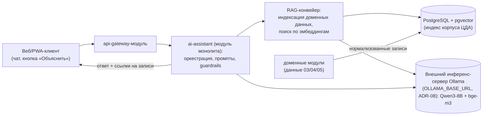

# Локальная ИИ на открытых весах (ИИ-блок ЦДА)

Статус: готово · Версия: 1.3 · Дата: 2026-11-08 · Автор: Иван Куликов

Опирается на docs/01-requirements.md (REQ-F-035..038), docs/02-architecture.md
(ADR-05, модуль ai-assistant), docs/06-data-api.md (API-33..35), CONTRACTS.md §4.
Ключевое ограничение пользователя: ИИ — **локальная**, на открытых весах; данные
хозяйства не покидают контур (REQ-F-036).

## 1. Назначение и границы

ИИ-блок — не «ещё один источник данных», а слой поверх доменных данных ЦДА:

1. AI-01. Ассистент агронома: вопросы по данным хозяйства (RAG по нормализованным
   данным домена), ответы только на основе данных ЦДА, со ссылками на записи [REQ-F-035].
2. AI-02. Генерация человекочитаемых объяснений рекомендаций из rationale правил
   RULE-* (REQ-NF-006, [REQ-F-037]).
3. AI-03. Сводки и разборы: журнал операций за период, разбор алертов [REQ-F-038].

Вне границ: принятие решений без человека (ИИ советует, решает агроном); прогнозы
урожайности и погоды как ML-задачи (на MVP — правила и внешние источники); генерация
агрохимических нормативов.

## 2. Модельный стек (открытые веса; инференс — внешний Ollama-сервер, ADR-08)

| Компонент | Выбор (MVP) | Обоснование | Альтернативы |
|---|---|---|---|
| LLM-диалог | Qwen3-8B-Instruct (или Llama-3.1-8B-Instruct) | сильный русский язык в открытых весах этого класса; 8B — баланс качества и железа | Mistral-7B, Vikhr (русскоязычная, дообучаемая) |
| Эмбеддинги для RAG | bge-m3 (мультиязычная) | компактная, русский в одном пространстве с доменными текстами | multilingual-e5-large, rubert-tiny2 (CPU) |
| Ранжер (опц.) | bge-reranker-v2-m3 | точность выдачи контекста при росте корпуса | — |
| Рантайм инференса | Внешний Ollama-сервер пользователя (ADR-08): адрес в OLLAMA_BASE_URL; альтернативно llama.cpp / vLLM тем же REST | сервер приложения без GPU; Ollama: простой REST для нескольких моделей; vLLM — при росте нагрузки | llama-cpp-python (CPU-only) |

Лицензии всех перечисленных весов допускают коммерческое использование (Apache-2.0 /
Llama Community / MIT); финальная версия фиксируется при старте реализации по
результатам замеров на целевом железе.

## 3. Архитектура ИИ-блока (см. ADR-05 в 02-architecture.md)



Принципы:

- Retrieval-first: LLM получает только найденные по индексу фрагменты доменных данных;
  ответы «не из системы» блокируются guardrails (проверка ссылок на entity_id).
- Индексация: доменные записи (поля, циклы, операции, погода, NDVI, рекомендации)
  сериализуются в текстовые карточки с entity-ссылками, эмбеддинг — bge-m3; хранение
  векторов — pgvector в той же PostgreSQL (ADR-02 сохраняется), обновление — по событиям
  шины (`operation.logged`, `scene.ingested` и др.).
- Объяснение рекомендаций (AI-02): вход — уже готовый `rationale` + `data_refs`
  ENT-RECOMMENDATION (03 §1.9); LLM только переформулирует, не придумывает числа.

## 4. Интерфейс ИИ-блока (API-33..35, дополняют 06-data-api.md)

| API | Метод и путь | Назначение |
|---|---|---|
| API-33 | POST /ai/chat | диалог: `{question, context?: {field_id?}, history[]}` → `{answer, refs: [ссылки на записи]}` |
| API-34 | POST /ai/explain | объяснение: `{recommendation_id}` → `{explanation}` (на основе rationale/data_refs) |
| API-35 | POST /ai/summary | сводка: `{period: {from, to}, scope: farm\|field_id}` → сводка журнала/алертов |

Пример ответа /ai/chat (§5-форматы):

```json
{"answer": "У поля Степное-7 предшественник — подсолнечник. Азот вносили 2 раза: 12.04 (36) и 20.05 (28 кг д.в./га).",
 "refs": [{"entity": "crop_cycle", "entity_id": "2f6e9d8a-4c1b-4d9a-8f7e-3b2c1a0d9e02"},
          {"entity": "field_operation", "entity_id": "f1e2d3c4-0a9b-4c8d-8e7f-a1b2c3d4e5f6"}]}
```

Деградация (REQ-NF-009): инференс-сервер недоступен → API-33..35 возвращают 503
problem+json; кнопки ИИ в UI скрываются, вся система работает без ИИ.

## 5. Железо и производительность

| Вариант | Конфигурация | Ожидание (8B, Q4-квантование) |
|---|---|---|
| Минимальный (CPU) | 32 ГБ RAM, 16+ ядер | 3–8 токенов/с — достаточно для объяснений и редких вопросов |
| Рекомендуемый (GPU) | 1× GPU 24 ГБ (класс RTX 4090 / A10) | 40–80 токенов/с, комфортный диалог нескольких пользователей |

Эмбеддинги считаются на CPU без заметной нагрузки; индекс хозяйства масштаба REQ-NF-001 —
десятки тысяч карточек, pgvector-индекс (HNSW) — миллисекунды. Одновременных
пользователей ИИ на хозяйстве — единицы: одного инстанса достаточно.

## 6. Безопасность и качество

- Данные хозяйства не уходят третьим лицам [REQ-F-036]: инференс — внешний
  Ollama-сервер самого пользователя (ADR-08), соединение по HTTPS; облака ИИ
  не используются; проверяется на приёмке трассировкой исходящих вызовов ИИ-блока
  (единственный допустимый адресат — OLLAMA_BASE_URL).
- Guardrails: ответ обязан опираться на refs; если релевантных данных нет — явный отказ
  «в системе нет данных по вопросу», без домыслов.
- Промпт-инъекции: пользовательский текст экранируется, системный промпт задаёт роль
  «отвечай только по данным ЦДА со ссылками».
- Оценка качества на приёмке: набор из ≥30 эталонных вопросов-ответов по тестовому
  хозяйству; порог — ≥80 % ответов с корректными refs (техника LLM-as-judge запрещена
  на приёмке — проверяет человек по чек-листу).

## 7. Риски и этапность

- Качество 8B-моделей на агротерминологии — риск MITIGATE: словарь доменных терминов
  (glossary.md) добавляется в системный промпт и в индекс RAG.
- Русский язык слабее у некоторых открытых моделей — тест двух кандидатов (Qwen3, Llama)
  на эталонных вопросах до фиксации выбора.
- Время ответа на CPU — терпимо для объяснений, но не для чата: чат — только в v1
  при наличии GPU (в MVP — AI-02/AI-03, Could-приоритет, см. 08-roadmap).

ИИ-блок включается в дорожную карту как отдельный блок v1 (после MVP) — зафиксировано
в docs/08-roadmap.md.

## 8. MVP-реализация в карточке поля (итерация v3-ai, 2026-11-07)

Решение пользователя (#284/#285): «Выводы ассистента» (AI-01b) и прогноз
урожайности включаются в MVP (снят запрет «прогнозы — не MVP» из §1 для
урожайности как эмпирической оценки по NDVI, а не ML-задачи). Данные и API —
docs/06 §7.4; здесь — логика, модельный стек и деградация.

### 8.1. LLM-клиент: Ollama или anthropic-совместимое облако (ADR-08, #115)

- Провайдер — env `LLM_PROVIDER`: `ollama` (по умолчанию, обратная
  совместимость) или `anthropic` — anthropic-совместимое облако
  (по умолчанию `https://api.z.ai/api/anthropic`, env `ANTHROPIC_BASE_URL`),
  модель `LLM_MODEL` (по умолчанию `glm-5.3-flash`). Ключ —
  `ANTHROPIC_API_KEY`, только из env; пустой ключ = ИИ-текст выключен
  (как пустой `OLLAMA_BASE_URL` для ollama), запросов нет вовсе.
- Ollama-ветка: внешний Ollama-сервер, адрес `OLLAMA_BASE_URL` (env, по
  умолчанию пуст = ИИ-текст выключен). Модель — `OLLAMA_MODEL`
  (по умолчанию `qwen3.5:9b`; выбор зафиксирован по тесту на сервере
  пользователя 192.168.99.201:11434 2026-11-07: qwen3.5:9b — корректный
  русский агро-текст, ~7 ток/с на CPU; gemma4:8B не уложился в 300 с).
  Таймауты (2026-11-07, измерен холодный старт модели 114 с): 60 с для
  синхронных вызовов (1 повтор); для фоновой генерации LLM-сводки (#93,
  пользователь не ждёт ответа) — 600 с без повтора, плюс опции
  `keep_alive: "30m"`, чтобы модель не выгружалась между сводками, и
  `num_predict: 256` — лимит длины генерации (CPU-инференс: без лимита
  сводка не успевала за прежние 300 с, #112).
- Anthropic-ветка (#115, запрос пользователя #352): POST
  `{ANTHROPIC_BASE_URL}/v1/messages` (заголовки `x-api-key`,
  `anthropic-version: 2023-06-01`), `max_tokens: 1024` — glm-5.3-flash
  думающая: thinking-блок в content идёт первым всегда (даже при
  thinking disabled), малые лимиты съедаются им — текст берём из первого
  content-блока type="text". Латентность облака — секунды, общий фоновый
  таймаут 600 с годится; 4xx — без повтора, 5xx/таймаут — 1 повтор.
- anthropic-ветка (v1.2, #116): в тело запроса всегда включается
  `"thinking": {"type": "disabled"}` — glm-5.3-flash всегда шлёт thinking-блок,
  который при малом бюджете съедает max_tokens и text не рождается (замер
  2026-11-08: при 1024 — thinking ~700–800 токенов и обрезка; с disabled —
  thinking-блок отсутствует, 6 с, end_turn). `ANTHROPIC_MAX_TOKENS`
  (default 3072) — запас на случай изменения поведения провайдера.
- Клиент — модуль `ai_assistant/llm.py`: `summarize(prompt, context) -> str | None`
  (общий вход, ветвление по провайдеру; `num_predict`/`think` — только
  ollama-ветка). Ollama: POST `{OLLAMA_BASE_URL}/api/generate` (stream off,
  top-level `think: false` — у think-моделей блок размышлений съедает весь
  `num_predict` и сводка остаётся пустой, #113; options: temperature 0.3,
  num_ctx 4096); `None` — сервер недоступен/таймаут.
- Данные хозяйства уходят только на адрес сконфигурированного провайдера
  (`OLLAMA_BASE_URL` либо `ANTHROPIC_BASE_URL`, REQ-F-036 сохраняется);
  guardrails: промпт строит только бэкенд, пользовательский ввод в MVP
  в промпт не попадает.


### 8.2. «Выводы ассистента» (AI-01b): детекторы + LLM-сводка

Числовые детекторы (модуль `ai_assistant/detectors.py`, всегда доступны,
без Ollama), вход — данные API-06/07/29 + осадки):

| code | severity | условие |
|---|---|---|
| ndvi_drop | warn/alert | NDVI чистых сцен упал ≥ 0.15 между соседними датами (alert при ≥ 0.25) |
| ndvi_stagnation | info | прирост NDVI < 0.05 за 3 чистые сцены в окне активной вегетации культуры: озимые (Озимая пшеница, Ячмень озимый, Рапс озимый, Рожь, Тритикале) — сентябрь–ноябрь и март–июнь, остальные культуры — апрель–октябрь; и среднее NDVI трёх сцен ≥ 0.3 (вне окна и при отсутствии вегетации стагнация — норма, не выводится) |
| waterlogging | warn/alert | правило вымокания §7.4: ndwi_p90 ≥ 0.10 ∧ ndvi_mean < 0.45 ∧ осадки 7 сут ≥ 20 мм, проверяется по ВСЕМ чистым сценам сезона (не только последней): выводится при наличии эпизодов waterlogged=true, detail перечисляет даты эпизодов и max ndwi_p90; alert — если эпизод на последней сцене или ndwi_mean ≥ 0.10 (попиксельная доля недоступна) |
| drought | warn | засуха по двум независимым сигналам (§7.7 #129): «осадки» — осадки 14 сут < 10 мм ∧ GDD за период выше нормы; «NDMI» — ndmi_mean < −0.1 при NDVI > 0.35 (влажность биомассы упала при живой вегетации, ранний сигнал до падения NDVI); detail указывает, какой сигнал сработал (осадки/NDMI/оба) |
| winterkill | info/warn | перезимовка озимых по зимним сценам (декабрь–март, §7.7 #129): доля сцен «оголённый посев без снега» (NDSI < 0.4 ∧ NDVI < 0.2); info при доле < 30 %, warn при ≥ 30 %; только для озимых культур (маркеры как у ndvi_stagnation) и только при наличии зимних сцен сезона; detail — даты и значения |
| ndvi_lag_last_year | info | отставание ndvi_mean ≥ 0.1 от той же даты прошлого сезона (появится со 2-го сезона данных) |
| agrochem_low | info | pH < 5.5 или гумус < 2 % по последней пробе |
| vra_heterogeneity | info | неоднородность подтверждена по пиковым сценам вегетации: пространственный разброс p90−p10 средних ячеек (spatial_spread) ≥ 0.06 ИЛИ IQR NDVI ≥ 0.12 минимум на 2 из топ-3 сцен сезона по index_avg (§7.4 v1.7) — есть зоны для дифвнесения, ссылка на /vra |

Каждый item — `{code, severity, title, detail, data_refs}` (refs на сцены/
циклы/пробы, формат §4). Пустые детекторы не возвращаются; если ничего не
сработало — items=[].

**LLM-вердикт обязателен по каждому полю (v1.3, фидбек #410):** при
доступном провайдере summary ВСЕГДА генерируется LLM, включая поля без
сработавших детекторов (items=[]) — модель даёт содержательный вердикт
агронома по контексту: состояние посева по NDVI-динамике сезона, агрохимии
и последним работам, что в норме и за чем следить дальше. Статическая
строка «отклонений не выявлено» — только деградация при недоступном LLM
(source=rules). Промпт явным указывает: «отсутствие сработавших детекторов
не повод для пустого ответа — охарактеризуй состояние поля по данным
контекста» (числа — только из контекста, guardrail действует как обычно).

LLM-сводка: вход — сериализованные items + контекст поля (культура сезона,
агрохимия, последние работы, NDVI-динамика сезона — даты и средние последних
чистых сцен, другие индексы сезона (§7.7, #153) — средние NDRE/NDMI/EVI/BSI
последних 2–3 чистых сцен вегетации (апрель–октябрь) и NDSI по зимним сценам
(декабрь–март, для озимых; только реально рассчитанные значения — нет сцен
индексов, секция не пишется), выводы моделей: вымокания по всем сценам сезона
и VRA — IQR, пространственный разброс и число зон дифвнесения по пиковым
сценам даже когда детекторы молчат), системный промпт «агроном-ассистент, по
фактическим данным, без выдуманных чисел, 1–2 абзаца, что проверить»
(интерпретация индексов: NDRE — азотный статус, NDMI — влажность биомассы,
EVI — вегетация, NDSI — снег, BSI — голая почва); LLM только переформулирует
items и выводы моделей, новые факты добавлять запрещено (проверка: числа
сводки должны встречаться в items/контексте — иначе fallback на конкатенацию
items).
Вывод — простой текст без markdown-разметки (запрет в промпте, #131):
остаточная разметка (жирный/курсив/заголовки/бэктики) срезается санитайзером
`strip_markdown` ПОСЛЕ guardrail, маркеры списков приводятся к тире.
Кэш и ручки — docs/06 §7.4.

### 8.3. Прогноз урожайности (эмпирика по NDVI, не ML)

Модель и коэффициенты — docs/06 §7.4. Стартовые коэффициенты per-культура
храним в `ref_culture` (колонки yield_k_base, yield_k_ndvi_max,
yield_k_ndvi_int; NULL → 422 `yield_no_model`); значения для пшеницы, ячменя,
кукурузы, подсолнечника, рапса — из агрономической практики NDVI→урожай,
фиксируются в seed и пересматриваются по мере накопления пар
«сезон NDVI + фактическая урожайность» (после 2–3 сезонов — линейная
регрессия по своим данным, отдельная задача, не MVP).

### 8.4. Приёмка итерации

- pytest: детекторы на синтетических сериях (drop/stagnation/waterlogging/
  drought), NDWI-расчёт на тестовом COG, VRA-зоны на синтетическом растре,
  прогноз по подставным коэффициентам, деградация без OLLAMA_BASE_URL.
- e2e: блок «Выводы ассистента» (rules-режим без Ollama), слой «Вымокания»
  в мини-карте, экран зон дифвнесения, чип прогноза урожайности.
- Эталонных вопросов LLM ≥ 30 (§6) — на приёмке чата (этап 2), не MVP.

### 8.5. Vision-анализ рендеров в сводке (#117, glm-5.3-flash)

glm-5.3-flash визуальная: при `LLM_PROVIDER=anthropic` фоновая LLM-сводка
§8.2 получает вместе с текстовым context PNG-рендеры поля (файловые §7.3,
base64, `media_type: image/png`, image-блоки перед текстовым):

- последняя чистая сцена: NDVI-раскраска, truecolor, NDWI;
- пик вегетации (по расчёту зон §7.4): NDVI;
- всего не более 4 изображений на вызов; в context добавляется подпись
  «Приложены рендеры…» с вариантами и датами (даты легальны для guardrail).

Промпт `VISION_PROMPT`: «агроном-аналитик спутниковых снимков» — резюме
детекторов + качественные визуальные наблюдения (пятна, градиенты, края
поля, следы техники), соотнесённые с числами детекторов. Guardrail §8.2
не ослабляется: числа ответа обязаны встречаться в items/context, иначе
повтор с уточнением и fallback на items.

Деградация: ollama-провайдер, пустой `NDVI_RENDER_DIR` или отсутствие
файлов рендеров — сводка уходит текстовым `PROMPT` без изображений
(текущее поведение §8.2). REQ-F-036: рендеры покидают контур только при
`LLM_PROVIDER=anthropic` — решение пользователя #352/#358 (как для текста
в #115/#116 и рендеров advice §9.1).

## 9. AI-рекомендации на текущую дату (эпик #118, 2026-11-08)

Решение пользователя (#358): ассистент даёт РЕКОМЕНДАЦИИ «что делать сейчас»,
не только сводку отклонений (§8.2). Активный провайдер — облачная модель
glm-5.3-flash (Anthropic Messages API, #115/#116); при `LLM_PROVIDER` = ollama
или без провайдера — деградация: advice не формируется (404 advice_not_ready
или null), детекторы §8.2 работают как раньше.

### 9.1. Контекст рекомендации (собирает бэкенд, пользовательский ввод не попадает)

Сериализуем в структурированный текст (`context`), все данные — из БД ЦДА:

1. поле: название, площадь га;
2. культура текущего сезона + история севооборота (последние 3–5 циклов:
   год, культура, предшественник);
3. агрохимия: последняя проба (pH, гумус, P2O5, K2O, дата);
4. работы: план (незавершённые операции с датами) + журнал (последние
   10 операций: дата, тип, культура, д.в./препарат);
5. NDVI текущего сезона: даты + index_avg/min/max чистых сцен (график
   сериализуется точками), отметка пика вегетации;
6. погода: факт за 14 сут (осадки, GDD — как в drought) + прогноз на 7 сут
   (дата, осадки мм, t min/max, риск осадков);
7. выводы моделей: вымокания (эпизоды сезона), АХО-рекомендации (активные),
   VRA-вердикт (IQR, пространственный разброс, число зон дифвнесения),
8. текущая дата — в системном промпте: «Сегодня {YYYY-MM-DD}».

Плюс image-блоки (только провайдер anthropic): PNG-рендеры NDVI последней
чистой сцены и пика вегетации (тот же рендер, что /vra/map.png; base64,
media_type image/png), не более 2 картинок на вызов.

### 9.2. Промпт

Системный: «Ты — агроном-ассистент цифрового двойника хозяйства. Сегодня
{date}. По данным хозяйства (context, включая спутниковые снимки) дай
рекомендации на текущий момент: 1) что сделать или проверить в ближайшие
дни с приоритетами; 2) окно работ с учётом прогноза погоды; 3) на что
обратить внимание по снимкам. 2–4 абзаца или короткий список. Только
факты из данных: числа (даты, дозы, осадки, NDVI) можно брать только из
context, свои нормативы и числа не выдумывать. Ты советуешь — решение
принимает агроном.»

Guardrail как в §8.2: числа ответа обязаны встречаться в context, иначе
повторный вызов с уточнением, затем fallback на конкатенацию items §8.2.
Уточнение v1.3 (#144, диагностика Светланы Куликовой): guardrail сверяет
не подстроки, а НОРМАЛИЗОВАННЫЕ числа — допустимы форматы представления
легального значения: ведущие нули («08» ≡ «8»), русская дата DD.MM и
DD.MM.YYYY для ISO-даты из context («10.11» ≡ «2026-11-10»). Недопустимо
(остаётся нарушением): арифметика и агрегация (суммы, интервалы «0–4 %»,
«до 5.2 мм» — числа, которых нет в context), числа с PNG-рендеров (их в
context нет). Промпт дополняется: даты и числа приводить в том же виде,
как в context (ISO-даты как в context или DD.MM), не пересчитывать и не
суммировать, не называть числа, видимые на рендерах, если их нет в
context (как в vision-сводке #117). Guardrail при нарушении, как и раньше:
повторный вызов с указанием, какие числа нелегальны, затем fallback.
Fallback при пустых детекторах (items нет) — честный текст «ответ не прошёл
проверку по данным хозяйства», а не «данных недостаточно»: контекст собран,
не справилась модель (#144).
Вывод — простой текст без markdown-разметки (запрет в промпте, #131):
остаточная разметка срезается санитайзером `strip_markdown` ПОСЛЕ
guardrail перед записью в `ai_field_advice`.

### 9.3. Хранение и API

Таблица `ai_field_advice` (миграция):

| колонка | тип | примечание |
|---|---|---|
| id | uuid pk | |
| field_id | uuid fk fields(id), index | |
| created_at | timestamptz default now(), index | момент генерации |
| model | text | напр. glm-5.3-flash / qwen3.5:9b |
| provider | text | anthropic / ollama |
| advice_date | date | дата «настоящего момента» (см. 9.4) |
| answer | text | текст рекомендации |
| context_hash | text | sha256 сериализованного context |
| status | text | ok / fallback / empty | 

История — только записи со status=ok/fallback; empty (нет данных сезона)
не пишем. Ретеншн не ограничен (объёмы копеечные: 1 запись/поле/день).

API (дополняют 06-data-api.md):

| API | Метод и путь | Назначение |
|---|---|---|
| API-55 | GET /fields/{field_id}/ai/advice | последняя рекомендация `{field_id, created_at, advice_date, model, provider, answer, status}`; нет — 404 `advice_not_found` |
| API-56 | GET /fields/{field_id}/ai/advice/history?from&to&limit | `{items: [… как API-55 …]}`, limit ≤ 100, default 30, desc по created_at |

Принудительный пересчёт: POST /fields/{field_id}/ai/advice (без тела) —
ставит генерацию в фоновую очередь, возвращает 202 `{status:"queued"}`;
результат — тем же GET (поллинг/фронт-обновление). Права — агроном+.

### 9.4. Когда пересчитывается

1. Планировщик: раз в сутки (по умолчанию 05:00 локального времени
   контейнера, env `AI_ADVICE_DAILY_AT=05:00`) для всех активных полей
   (у которых есть сцены текущего сезона); сериализация очереди, параллелизм
   `AI_ADVICE_PARALLELISM` (default 3; для anthropic можно, для ollama = 1).
2. Событийно: новая чистая сцена NDVI (по тем же событиям, что сбрасывают
   кэш insights §7.4) → поле в очередь.
3. Вручную: POST API-55 или CLI `python -m app.cli advice-refresh
   [--field-id …]` (без аргумента — все поля; идемпотентен: пропускает
   поля, у которых advice за сегодня с тем же context_hash).

Вчерашние рекомендации не пересчитываются задним числом: advice_date = дата
генерации; исторические сезоны advice не получают (это режим «сейчас»).

### 9.5. Деградация и приватность

- Провайдер недоступен → advice остаётся последним успешным, новых записей
  нет; API-55 отдаёт последнюю с `created_at`; фронт показывает дату.
- REQ-F-036: при `LLM_PROVIDER=anthropic` context и рендеры уходят в облако
  z.ai — решение пользователя #352/#358 (текстовая сводка §8.1 — так же).
- Ошибка провайдера — запись не создаётся (лог warn), очередь продолжает
  остальные поля.

## 10. Агентный режим с инструментами (направление, предложено пользователем #376)

Проверено 2026-11-08 живыми запросами: glm-5.3-flash поддерживает tool use
Anthropic Messages API (tools + блоки tool_use/tool_result, параллельные
вызовы, дозапрос недостающих инструментов).

Применение — этап 2, чат AI-01 (API-33): вместо сборки полного контекста
бэкендом модель сама выбирает данные через read-only инструменты
(get_field_summary, get_ndvi_series, get_operations, get_weather_forecast,
get_vra, get_renders…), белым списком, до N раундов. Плюсы: контекст не
раздувается, новые данные не требуют правки промпта, вопрос заранее
неизвестен. Для ежедневных рекомендаций §9 (регламентированный набор данных,
дешевизна, детерминированность guardrail) остаётся фиксированный контекст:
агентный режим дороже (несколько раундов) и менее воспроизводим; возможно
гибридное объединение позже.
