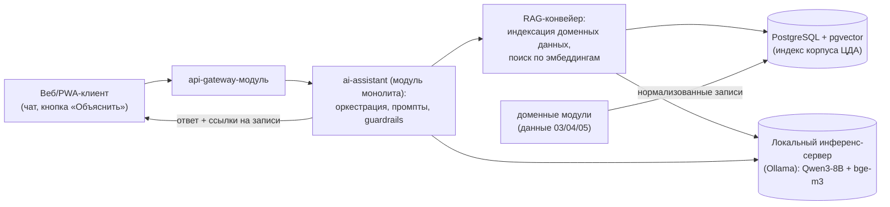

# Локальная ИИ на открытых весах (ИИ-блок ЦДА)

Статус: готово · Версия: 1.0 · Дата: 2026-11-05 · Автор: Иван Куликов

Опирается на docs/01-requirements.md (REQ-F-035..038), docs/02-architecture.md
(ADR-05, модуль ai-assistant), docs/06-data-api.md (API-33..35), CONTRACTS.md §4.
Ключевое ограничение пользователя: ИИ — **локальная**, на открытых весах; данные
хозяйства не покидают контур (REQ-F-036).

## 1. Назначение и границы

ИИ-блок — не «ещё один источник данных», а слой поверх доменных данных ЦДА:

1. AI-01. Ассистент агронома: вопросы по данным хозяйства (RAG по нормализованным
   данным домена), ответы только на основе данных ЦДА, со ссылками на записи [REQ-F-035].
2. AI-02. Генерация человекочитаемых объяснений рекомендаций из rationale правил
   RULE-* (REQ-NF-006, [REQ-F-037]).
3. AI-03. Сводки и разборы: журнал операций за период, разбор алертов [REQ-F-038].

Вне границ: принятие решений без человека (ИИ советует, решает агроном); прогнозы
урожайности и погоды как ML-задачи (на MVP — правила и внешние источники); генерация
агрохимических нормативов.

## 2. Модельный стек (открытые веса; инференс — внешний Ollama-сервер, ADR-08)

| Компонент | Выбор (MVP) | Обоснование | Альтернативы |
|---|---|---|---|
| LLM-диалог | Qwen3-8B-Instruct (или Llama-3.1-8B-Instruct) | сильный русский язык в открытых весах этого класса; 8B — баланс качества и железа | Mistral-7B, Vikhr (русскоязычная, дообучаемая) |
| Эмбеддинги для RAG | bge-m3 (мультиязычная) | компактная, русский в одном пространстве с доменными текстами | multilingual-e5-large, rubert-tiny2 (CPU) |
| Ранжер (опц.) | bge-reranker-v2-m3 | точность выдачи контекста при росте корпуса | — |
| Рантайм инференса | Внешний Ollama-сервер пользователя (ADR-08): адрес в OLLAMA_BASE_URL; альтернативно llama.cpp / vLLM тем же REST | сервер приложения без GPU; Ollama: простой REST для нескольких моделей; vLLM — при росте нагрузки | llama-cpp-python (CPU-only) |

Лицензии всех перечисленных весов допускают коммерческое использование (Apache-2.0 /
Llama Community / MIT); финальная версия фиксируется при старте реализации по
результатам замеров на целевом железе.

## 3. Архитектура ИИ-блока (см. ADR-05 в 02-architecture.md)



Принципы:

- Retrieval-first: LLM получает только найденные по индексу фрагменты доменных данных;
  ответы «не из системы» блокируются guardrails (проверка ссылок на entity_id).
- Индексация: доменные записи (поля, циклы, операции, погода, NDVI, рекомендации)
  сериализуются в текстовые карточки с entity-ссылками, эмбеддинг — bge-m3; хранение
  векторов — pgvector в той же PostgreSQL (ADR-02 сохраняется), обновление — по событиям
  шины (`operation.logged`, `scene.ingested` и др.).
- Объяснение рекомендаций (AI-02): вход — уже готовый `rationale` + `data_refs`
  ENT-RECOMMENDATION (03 §1.9); LLM только переформулирует, не придумывает числа.

## 4. Интерфейс ИИ-блока (API-33..35, дополняют 06-data-api.md)

| API | Метод и путь | Назначение |
|---|---|---|
| API-33 | POST /ai/chat | диалог: `{question, context?: {field_id?}, history[]}` → `{answer, refs: [ссылки на записи]}` |
| API-34 | POST /ai/explain | объяснение: `{recommendation_id}` → `{explanation}` (на основе rationale/data_refs) |
| API-35 | POST /ai/summary | сводка: `{period: {from, to}, scope: farm\|field_id}` → сводка журнала/алертов |

Пример ответа /ai/chat (§5-форматы):

```json
{"answer": "У поля Степное-7 предшественник — подсолнечник. Азот вносили 2 раза: 12.04 (36) и 20.05 (28 кг д.в./га).",
 "refs": [{"entity": "crop_cycle", "entity_id": "2f6e9d8a-4c1b-4d9a-8f7e-3b2c1a0d9e02"},
          {"entity": "field_operation", "entity_id": "f1e2d3c4-0a9b-4c8d-8e7f-a1b2c3d4e5f6"}]}
```

Деградация (REQ-NF-009): инференс-сервер недоступен → API-33..35 возвращают 503
problem+json; кнопки ИИ в UI скрываются, вся система работает без ИИ.

## 5. Железо и производительность

| Вариант | Конфигурация | Ожидание (8B, Q4-квантование) |
|---|---|---|
| Минимальный (CPU) | 32 ГБ RAM, 16+ ядер | 3–8 токенов/с — достаточно для объяснений и редких вопросов |
| Рекомендуемый (GPU) | 1× GPU 24 ГБ (класс RTX 4090 / A10) | 40–80 токенов/с, комфортный диалог нескольких пользователей |

Эмбеддинги считаются на CPU без заметной нагрузки; индекс хозяйства масштаба REQ-NF-001 —
десятки тысяч карточек, pgvector-индекс (HNSW) — миллисекунды. Одновременных
пользователей ИИ на хозяйстве — единицы: одного инстанса достаточно.

## 6. Безопасность и качество

- Данные хозяйства не уходят третьим лицам [REQ-F-036]: инференс — внешний
  Ollama-сервер самого пользователя (ADR-08), соединение по HTTPS; облака ИИ
  не используются; проверяется на приёмке трассировкой исходящих вызовов ИИ-блока
  (единственный допустимый адресат — OLLAMA_BASE_URL).
- Guardrails: ответ обязан опираться на refs; если релевантных данных нет — явный отказ
  «в системе нет данных по вопросу», без домыслов.
- Промпт-инъекции: пользовательский текст экранируется, системный промпт задаёт роль
  «отвечай только по данным ЦДА со ссылками».
- Оценка качества на приёмке: набор из ≥30 эталонных вопросов-ответов по тестовому
  хозяйству; порог — ≥80 % ответов с корректными refs (техника LLM-as-judge запрещена
  на приёмке — проверяет человек по чек-листу).

## 7. Риски и этапность

- Качество 8B-моделей на агротерминологии — риск MITIGATE: словарь доменных терминов
  (glossary.md) добавляется в системный промпт и в индекс RAG.
- Русский язык слабее у некоторых открытых моделей — тест двух кандидатов (Qwen3, Llama)
  на эталонных вопросах до фиксации выбора.
- Время ответа на CPU — терпимо для объяснений, но не для чата: чат — только в v1
  при наличии GPU (в MVP — AI-02/AI-03, Could-приоритет, см. 08-roadmap).

ИИ-блок включается в дорожную карту как отдельный блок v1 (после MVP) — зафиксировано
в docs/08-roadmap.md.
